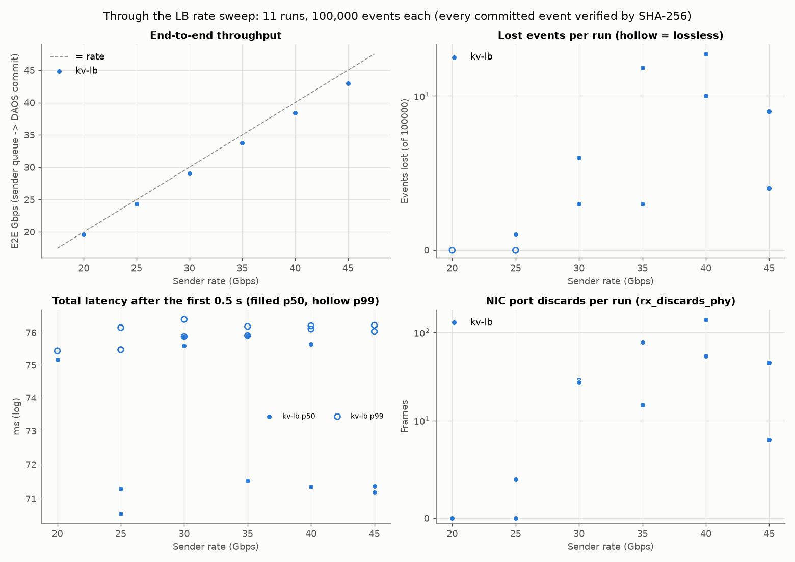
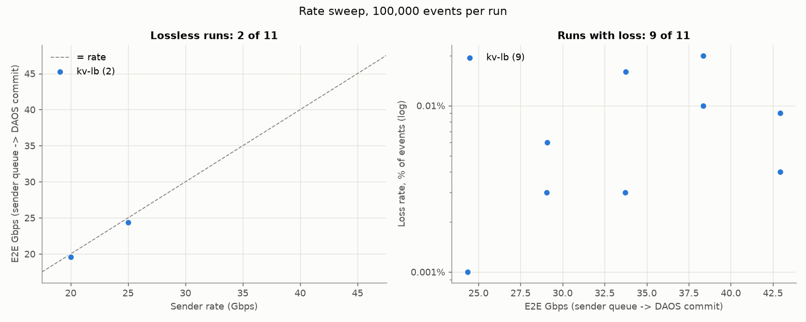

# End-to-end benchmark: synthetic EVIO frames → E2SAR → DAOS

How fast synthetic EVIO streaming time frames go from a sender on **ebpf2201**, through E2SAR (node-to-node or through the ESnet EJFAT load balancer), to `e2sar_daos_recv` on **ebpf2203** and into DAOS, without losing any. Also where each event's time goes on the way.
Measured on 2026-10-19 with E2SAR 0.4.0rc1, DAOS 2.6.5 (pool `sc26`) and LB 638 on `ejfat-lb.es.net`. The node-to-node rate sweep from 20 to 50 Gbps ([section 7](#7-node-to-node-rate-sweep-2050-gbps-2026-10-20)) is from 2026-10-20, and the LB rate sweep ([section 9](#9-lb-rate-sweep-2045-gbps-2026-10-21)) from 2026-10-21 on LB 640. New LB runs should use ESnet's `stable4` LB (control plane `192.188.29.6:18048`, data plane `192.188.29.54`), see [ESNET_LB_TESTING.md](ESNET_LB_TESTING.md).

## Summary

| | Result |
|---|---|
| **Highest lossless E2E, through the LB** | **24.3 Gbps** E2E (25.2 received) on LB 640, 2026-10-21: 1 of 2 runs at 25 Gbps, and every run at 30–45 Gbps lost 3–20 events, all in the first 0.5 s. See [section 9](#9-lb-rate-sweep-2045-gbps-2026-10-21). On 2026-10-19 (LB 638, 16 dequeue threads), 35 Gbps (33.7 E2E) was lossless in 2 of 2 runs |
| Highest lossless E2E, node-to-node | **29.9 Gbps** E2E (30.3 received), in 1 of 6 runs at 30 Gbps. 25 Gbps: 2 of 6. No run at 35–50 Gbps was lossless, and no rate was lossless in every run. See [section 7](#7-node-to-node-rate-sweep-2050-gbps-2026-10-20) |
| KV vs files through pil4dfs, 95 KB events | **KV.** pil4dfs (one file per event, `-S pil4dfs`, 32 writers) takes 0.9–1.7 ms per file and commits at most 18–33k events/s (13–25 Gbps). From 20 Gbps up it falls behind, and events queue for seconds. KV takes 0.23–0.30 ms and keeps up to 50 Gbps. See [section 7](#kv-vs-files-through-pil4dfs) |
| Node-to-node after the first 0.5 s | **No loss up to 50 Gbps in 39 of 42 runs.** Almost all lost events were queued in the first 0.1 s of a run, while the receiver's first DAOS writes are slow |
| Lossless in every run | **20 Gbps through the LB (3 of 3)**, the new defaults. Node-to-node the same settings passed 1 of 3 |
| Highest with any loss | 61.2 Gbps received (59.8 E2E), node-to-node, 99.96% of events delivered |
| What loses events | Frames dropped at ebpf2203's NIC port (`rx_discards_phy`). The LB path smooths the bursts, so loss starts later through it than node-to-node. Never DAOS, never the sockets. Why the port overflows is not settled yet: see [Diagnosing the port discards](#diagnosing-the-port-discards) |
| What limits the rate | 1. The DAOS dequeue threads: 4 cap at ~24 Gbps, 16 reach 40, 32 reach 61. 2. Then the Reassembler at ~85k events/s, whatever the event size |
| The DAOS sink alone | Without a sender (`--synthetic`), the KV sink at the defaults commits **92–103 Gbps** of 95 KB events and 183 Gbps of 1.5 MB events (the IB link). DAOS isn't what limits E2E. See [section 7](#7-the-sink-without-a-sender---synthetic) |
| Latency at the defaults | Queued at the sender → committed in DAOS: **0.3–0.5 ms p50** node-to-node, most of it the DAOS write. **75.6 ms p50** through the LB, almost all of it the WAN round trip to ESnet. See [latency per stage](#latency-per-stage-ms-same-runs) |
| Latency node-to-node, 20–50 Gbps | After the first 0.5 s: **0.2–1.0 ms p50, 0.4–2.6 ms p99** at every rate, DAOS 0.23–0.30 ms of it. The first 0.2–0.4 s of each run wait up to ~170 ms, which is the whole-run p99 of 116–167 ms. See [section 7](#latency-per-stage-node-to-node-ms) |
| iperf3 baseline | Partial (2026-10-15, DAOS idle). TCP into ebpf2203 reaches 98 Gbps, so the link, port and PCIe path sustain about line rate. UDP stopped at the iperf3 sender's ~20 Gbps with 0 loss, so there is no zero-loss UDP rate above 20 Gbps yet. See [what the evidence says](#what-the-evidence-says-so-far) |

## The pieces

```
ebpf2201                                                         ebpf2203
e2sar_evio_send                                                  e2sar_daos_recv
  P Segmenters (dataId 4321+i), paced                              T receive threads (ports PORT..PORT+T-1)
  each event = EVIO v6 record of F time frames  ──UDP──▶ [LB] ──▶  Reassembler ──▶ D dequeue threads ──▶ DAOS KV
                                                                                  (own event queue, I puts each)
```

| Tool | What it does |
|---|---|
| [`bin/e2sar_evio_send`](../bin/e2sar_evio_send.cpp) | Builds synthetic EVIO v6 events and sends them with P E2SAR Segmenters, paced to a total rate. Writes per-event send times and the SHA-256 of every event it can send |
| [`bin/e2sar_daos_recv`](../bin/README.md#e2sar_daos_recv) | The existing receiver. It now prints its clock start so its per-event times can be matched with the sender's. `--synthetic` measures it without a sender ([section 7](#7-the-sink-without-a-sender---synthetic)) |
| [`bin/e2sar_e2e_bench.sh`](../bin/e2sar_e2e_bench.sh) | Runs one test: starts the receiver, waits for it (and the LB) to be ready, sends, waits for every commit, reads every event back from DAOS, analyzes, cleans up |
| [`bin/e2sar_e2e_analyze.py`](../bin/e2sar_e2e_analyze.py) | Joins the two hosts' per-event times, checks every digest, computes throughput and latency per stage. `--profile S` shows latency and loss per S-second slice of the run |
| [`bin/e2sar_e2e_sweep.sh`](../bin/e2sar_e2e_sweep.sh) | Runs a rate sweep of the bench from a machine that can SSH to both nodes |

You don't need a different receiver. `e2sar_daos_recv` stores any event, and the bench checks that what it stored is byte-for-byte what was sent.

### Synthetic EVIO frames

Each E2SAR event is one EVIO v6 record holding F frames (`-f`, default 256), with the layout of the CODA streaming data in `frames_thread0_*.evio` and `EC5_EC6_cosmics_*.evio`:

```
Record header (14 words, magic 0xc0da0100, bit info 0x80004206) + index array when F > 1
└─ Built time frame          bank 0xFF60, bank of banks            × F
   ├─ Stream info            bank 0xFF31: TSS 0x32 (frame, timestamp), AIS 0x42 (one word per ROC)
   └─ ROC 0x12, 0x13         bank of banks
      ├─ ROC stream info     bank 0xFF30: TSS 0x31, AIS 0x41 (port info)
      └─ Payload banks       tags 1, 3, …, 15; ~74% empty, as in the real data; hit words otherwise
```

- A frame is ~423 bytes on average (the cosmics data: 426). Frame n has timestamp n × 65,536 ns.
- 256 frames make a ~95 KB event, and 4096 frames ~1.5 MB.
- Each Segmenter sends events numbered 1…N. Event n is copy n mod 64 of 64 distinct events built at start, so every event's digest is known in advance. The bench reads **every** event back from DAOS and checks its digest.
- Each Segmenter has its own dataId (4321 + i), so DAOS keys never collide: `<prefix>/<evt>/<dataId>/<chunk>`. See the [example of the keys of a bench run](../bin/README.md#example-events-from-e2sar_evio_send).
- Events get random entropy, so through the LB they spread over the receiver's T ports. Node-to-node (no LB), Segmenter i sends to port PORT + i (`--port-per-segmenter`), so only P receive threads get traffic. The staged E2SAR 0.4.0rc1 has no `multiPort` sender option.
- `--rate` is the total over all Segmenters. Each producing thread paces its own share by bytes. The Segmenter's own rate limit works in whole microseconds per event, too coarse for small events.
- To stream real time frames, with a different frame count in every record, see the proposal in [STREAMING_SENDER.md](STREAMING_SENDER.md).

## How to run

Prerequisites as in [ESNET_LB_TESTING.md](ESNET_LB_TESTING.md), steps 1–2: `~/.bashrc` with `E2SAR_BIN` and, for LB runs, `EJFAT_URI`, and e2sar-daos built in `~/daq/e2sar-daos`.
The nodes can't SSH to each other, so start the two roles in two terminals, one per node, with the **same TAG and mode**. They meet through files in the shared `$HOME/e2sar_run/bench/<TAG>/`.

```bash
# ebpf2203 (receiver), start first
bash ~/daq/e2sar-daos/bin/e2sar_e2e_bench.sh recv run1 -m lb
# ebpf2201 (sender)
bash ~/daq/e2sar-daos/bin/e2sar_e2e_bench.sh send run1 -m lb
```

`-m lb` goes through the LB in `$EJFAT_URI` (both sides `--withcp`). `-m n2n` sends straight to ebpf2203.
Both sides wait for each other: the sender until the receiver is listening (and, with the LB, has slots), the receiver until the sender is done and every event is committed (or 15 s without progress).
The receiver then prints the result:

```
run1 PASS  mode=lb P=16 s=1 f=256 rate=20.0 T=32 D=16x128 C=1024  committed 100000/100000, verified 100000
  received 19.97 Gbps (26238 evt/s, 95161 B/event)  e2e 19.80 Gbps  sender 19.97 Gbps
  latency sender   p50     0.070  p90     0.077  p99     0.100  max 2.1 ms
  latency network  p50    ...
  latency daos     p50     0.230  ...
  latency total    p50    ...
  drops: rx_discards_phy 0 rx_out_of_buffer 0 UdpRcvbufErrors 0
```

The same as one JSON line goes to `$RUN/bench/results.jsonl`. The exit status is 0 only for PASS.

| Option | Side | Default | |
|---|---|---|---|
| `-m lb\|n2n` | both | `lb` | Through the LB, or node-to-node |
| `-P` | send | 16 | Segmenters, each with its own producing thread and dataId |
| `-s` | send | 1 | Send sockets (threads) per Segmenter |
| `-n` | send | 6250 | Events per Segmenter (100,000 in total by default) |
| `-f` | send | 256 | EVIO frames per event (~95 KB) |
| `-r` | send | 20 | Total rate in Gbps (−1: unlimited) |
| `-T` | recv | 32 | Receive threads (ports). Node-to-node, use T ≥ P |
| `-D`, `-I` | recv | 16, 128 | Dequeue threads, and in-flight puts per thread |
| `-C` | recv | 1024 | DAOS chunk size in KiB (0: whole event in one value). KV sink only |
| `-S kv\|dfuse\|pil4dfs` | recv | `kv` | Where events go: the DAOS KV object (all results here), or files through dfuse. See [DFUSE_TESTING.md](DFUSE_TESTING.md) |

Environment overrides: `SEND_IP`, `RECV_IP`, `PORT` (20600), `POOL` (`sc26`), `CONT` (`e2sar-bench`), `NIC`, `RUN`, and `SEND_ARGS` for extra `e2sar_evio_send` options (`SEND_ARGS="-b 8388608"` for an 8 MiB send socket buffer).

- **Check that the nodes are idle first,** as in [ESNET_LB_TESTING.md step 4](ESNET_LB_TESTING.md). The receiver refuses to start if `PORT` is in use.
- **Clean-up is built in.** The receiver destroys the container after reading it back. There are no source files: the sender builds its events in memory. Each run leaves only its logs and CSVs in `$RUN/bench/<TAG>/`. For 100,000 events that's about 10 MB.
- **A run fails** when any event is missing or has the wrong digest. `rx_discards_phy` > 0 almost always comes with it.

## What is measured

All rates are Gbps (10⁹ bit/s) of event payload, meaning the EVIO records. E2SAR, LB, UDP and IP headers are not counted.

| Metric | Formula | Where |
|---|---|---|
| **Received** | Bytes of all committed events except the first one to commit / (last commit − first commit) | Receiver only. The steady rate at which events land in DAOS |
| **E2E** | All committed bytes / (first event queued at the sender → last event committed in DAOS) | Both hosts' clocks |
| Sender | Bytes sent / (first queued → last packet sent) | Sender only |

Latency per event, matched on (event number, dataId):

| Stage | From → to | What's in it |
|---|---|---|
| **sender** | Handed to the Segmenter → its last packet sent | Waiting in the Segmenter's queue, segmenting, sending |
| **network** | Last packet sent → a dequeue thread takes the reassembled event | Wire (+ LB and WAN), reassembly, and **waiting in the Reassembler's queue for a free dequeue thread** |
| **daos** | Taken by a dequeue thread → its metadata key committed | The chunk puts and the metadata put |
| **total** | Handed to the Segmenter → committed | Everything |

- Both clocks are chrony-synced to JLab NTP, with offsets of 0.03–0.09 ms, so the cross-host stages are good to about ±0.2 ms.
- The "network" stage includes the wait for a dequeue thread. When the dequeue threads are the bottleneck, it's that wait that grows, not "daos". See [the dequeue thread sweep](#3-dequeue-threads-the-hidden-bottleneck).
- With an unpaced sender, events wait in the sender's queue, so "sender" and "total" mostly measure the backlog. Use a paced sender (`-r`) for latency.
- `latency_steady_ms` in `result.json` ("after 0.5 s" in the summary) has the same stages for the events queued 0.5 s or more after the first one (`e2sar_e2e_analyze.py --warmup`). The start of every run is slow (see [section 7](#warm-up-at-the-start-of-each-run)), and in a run of 1.5–4 s it decides p90 and p99. `lost_queued_s` lists when the lost events were queued.

## Results (node-to-node unless stated)

### 1. Event size, unpaced, 4 Segmenters, 4 dequeue threads

| Frames/event | Event | Received | Events/s | Committed | NIC discards |
|---|---|---|---|---|---|
| 1 | 424 B | 0.29 Gbps | 85,396 | 200,000 / 200,000 | 0 |
| 16 | 6.0 KB | 3.60 Gbps | 74,923 | 199,995 / 200,000 | 5 |
| 256 | 95 KB | 30.7 Gbps | 40,344 | 49,835 / 50,000 | 1,206 |
| 4096 | 1.5 MB | 40.6 Gbps | 3,335 | 4,873 / 5,000 | 2,201 |
| 16384 | 6.1 MB | 53.7 Gbps | 1,102 | 1,966 / 2,000 | 636 |

One frame per event, as the DAQ writes them, tops out at ~85k events/s, only 0.3 Gbps. Throughput needs many frames per event.
Unpaced, the sender reaches 77–94 Gbps and overruns ebpf2203's NIC port.

### 2. Pacing and burst size

| Setting | Rate | Received | Committed | NIC discards |
|---|---|---|---|---|
| 4 × 2 sockets, 1.5 MB events | 20 | 20.0 | 9,948 / 10,000 | 495 |
| same | 40 | 39.8 | 9,846 / 10,000 | 1,199 |
| 1 Segmenter × 1 socket, 1.5 MB, unpaced | (12.0) | 12.0 | **5,000 / 5,000** | 0 |
| 4 × 2 sockets, **95 KB** events | 10 | 10.0 | **100,000 / 100,000** | 0 |
| same | 20 | 19.6 | **100,000 / 100,000** | 0 |

Pacing alone doesn't stop the discards with 1.5 MB events. Each event leaves one send thread as a ~10 Gbps line-rate burst, and the bursts of several Segmenters overlap at the receiving port.
With 95 KB events the bursts are 16× shorter, and 20 Gbps is lossless.

### 3. Dequeue threads: the hidden bottleneck

16 Segmenters, 95 KB events:

| Dequeue threads | Rate | Received | network p50 | daos p50 | Committed | NIC discards |
|---|---|---|---|---|---|---|
| 4 | 30 | 30.1 | 27 ms | 0.28 ms | 99,993 / 100,000 | 33 |
| 4 | 40 | **24.3** | **694 ms** | 0.33 ms | 100,000 / 100,000 | 0 |
| 16 | 40 | **40.5** | **0.20 ms** | 0.22 ms | 99,981 / 100,000 | 92 |
| 32 | 50 | 51.0 | 0.29 ms | 0.24 ms | 99,946 / 100,000 | 311 |
| 32 | 60 | **61.2** | 0.15 ms | 0.33 ms | 99,960 / 100,000 | 281 |
| 64 | 60 | 62.0 | 181 ms | 0.86 ms | 99,988 / 100,000 | 96 |
| 64 | 80 | 65.3 | 335 ms | 1.02 ms | 99,972 / 100,000 | 148 |

- With 4 dequeue threads the receiver can't go past ~24 Gbps at this event size. The events wait up to a second in the Reassembler's queue, but each DAOS write still takes only 0.3 ms. The per-event "daos" latency looks fine while the dequeue stage is the bottleneck.
- 16 threads reach 40 Gbps, and 32 reach 61 Gbps.
- 64 threads don't help. The receiver stays at ~85k events/s, the same ceiling as for 424-byte events, so that limit is per event (the E2SAR Reassembler), not per byte or in DAOS. `--deq` is independent of `--threads`.
- That's why `e2sar_daos_recv` now defaults to `--deq 16 --inflight 128`.

### 4. Highest lossless rate

16 Segmenters × 1 socket, 95 KB events, 16 dequeue threads, 100,000 events per run.

Node-to-node:

| Rate | Runs | Lossless | Received | E2E | Lost events | NIC discards |
|---|---|---|---|---|---|---|
| 25 | 2 | 1 | 25.2 | 24.9 | 0, 4 | 0, 4 |
| 30 | 2 | 0 | 30.2 | 29.9 | 8, 26 | 50, 142 |
| 35 | 2 | 0 | 35.3 | 34.9 | 5, 14 | 15, 66 |

Through LB 638:

| Rate | Runs | Lossless | Received | E2E | Lost events | NIC discards |
|---|---|---|---|---|---|---|
| 20 | 3 | **3** | 20.0 | 19.6 | 0, 0, 0 | 0, 0, 0 |
| 25 | 2 | 1 | 25.1 | 24.3 | 0, 17 | 0, 75 |
| 30 | 2 | 1 | 30.2 | 29.1 | 0, 10 | 0, 52 |
| **35** | 2 | **2** | **35.3** | **33.7** | 0, 0 | 0, 0 |
| 40 | 2 | 0 | 40.4 | 38.3 | 11, 177 | 35, 1,127 |
| 45 | 2 | 0 | 45.5 | 42.9 | 5, 7 | 6, 51 |

Loss doesn't rise smoothly with the rate. Between 25 and 35 Gbps a run either has no discards at all or a short burst of them. With 2–3 runs per rate, the numbers give a rough idea of how often that happens, not a sharp threshold. From 40 Gbps up, every run lost events.

Every lost event, in both modes, came with NIC port discards on ebpf2203. There were no socket drops (`UdpRcvbufErrors` 0), no ring overflows (`rx_out_of_buffer` 0), no reassembly or enqueue loss, and no failed DAOS writes.

### 5. Confirmation runs with the defaults

16 Segmenters × 1 socket, 95 KB events, 20 Gbps, 32 receive threads, 16 × 128 dequeue, 1 MiB chunks, 100,000 events (9.5 GB) per run, alternating modes:

| Mode | Run | Result | Received | E2E | Lost events | NIC discards |
|---|---|---|---|---|---|---|
| node-to-node | 1 | FAIL | 20.09 | 19.95 | 2 | 2 |
| node-to-node | 2 | FAIL | 20.09 | 19.95 | 15 | 25 |
| node-to-node | 3 | **PASS** | 20.09 | 19.95 | 0 | 0 |
| **LB** | 1 | **PASS** | 20.07 | 19.58 | 0 | 0 |
| **LB** | 2 | **PASS** | 20.05 | 19.57 | 0 | 0 |
| **LB** | 3 | **PASS** | 20.03 | 19.57 | 0 | 0 |

**Through the LB, 20 Gbps was lossless every time, with 0 NIC discards. Node-to-node, the same traffic lost a few events in 2 of 3 runs.**
The LB path (ESnet WAN and the LB's FPGA data plane) evidently smooths the line-rate bursts of each event before they reach ebpf2203. Node-to-node they arrive straight from the sender's NIC.
E2E is 0.4 Gbps lower through the LB only because of the extra ~75 ms before the first event lands.

#### Latency per stage (ms), same runs

| Mode | Stage | p50 | p90 | p99 | max |
|---|---|---|---|---|---|
| node-to-node | sender | 0.07–0.10 | 0.09–0.13 | 0.14–0.17 | 2–3 |
| | network | 0.02–0.11 | 0.07–0.19 | 54–58 | 66–68 |
| | daos | 0.22–0.24 | 0.26–0.33 | 0.9–1.3 | 45–46 |
| | **total** | **0.32–0.46** | **0.40–0.62** | **56–61** | 82–88 |
| LB | sender | 0.09–0.10 | 0.11–0.13 | 0.14–0.18 | 1.7–3.0 |
| | network | 75.2–75.3 | 75.5 | 122–130 | 139–144 |
| | daos | 0.22–0.23 | 0.26 | 0.85–1.18 | 44–47 |
| | **total** | **75.5–75.6** | **75.8–75.9** | **126–133** | 155–158 |

- **Node-to-node, most of an event's 0.3–0.5 ms goes to DAOS** (0.22 ms for one 95 KB put plus the metadata put). The sender needs ~0.1 ms, and the wire plus reassembly is within the ±0.2 ms clock error. Values that small (and the occasional slightly negative one) are clock noise.
- **Through the LB, the WAN dominates: ~75 ms**, the round trip from JLab to the ESnet LB and back (the path's RTT is 71 ms). Everything else is the same as node-to-node.
- **The p99 tail of ~55 ms (node-to-node) or ~50 ms over the WAN** is in the "network" stage, so events then wait for a dequeue thread. The "daos" stage has its own tail of ~45 ms at the very end (max). Both look like occasional DAOS stalls of tens of milliseconds, which hold up a dequeue thread and the events queued behind it.

### 6. DAOS layout: chunks, or one value per event

`e2sar_daos_recv` stores each event in one KV object as `<prefix>/<evt>/<dataId>/<chunk>` values of `--chunk` KiB, plus a metadata key written last. (These runs used one shared object for all runs. Now each run gets its own object, with the same keys, see [bin/README.md](../bin/README.md#data-layout-in-daos).)
For events up to 1 MiB, including the default 95 KB, "by chunk" and "by dataId" are the same thing: one data put and one metadata put per event.
They differ only for bigger events. Compared with 1.5 MB events (4096 frames, 16 dequeue threads, 10,000 events), 1 MiB chunks (2 puts in parallel) vs `--chunk 0` (the whole event as one value):

| Rate | Chunk | Received | daos p50 | daos p90 | daos p99 | Committed | NIC discards |
|---|---|---|---|---|---|---|---|
| 20 | 1 MiB | 19.43 | **0.57** | **1.32** | 22.4 | 9,673 | 4,215 |
| 20 | whole event | 19.72 | 1.15 | 1.69 | 26.3 | 9,813 | 1,187 |
| 40 | 1 MiB | 40.43 | **0.55** | **0.71** | 22.7 | 9,985 | 267 |
| 40 | whole event | 40.34 | 0.66 | 0.87 | 24.3 | 9,979 | 121 |

- **Throughput: no difference.** DAOS isn't the limit at either rate. The lost events all come from NIC discards, which 1.5 MB line-rate bursts cause node-to-node regardless of the DAOS layout.
- **Latency: 1 MiB chunks are slightly faster** (0.55–0.57 vs 0.66–1.15 ms p50), because one event's chunks are written in parallel.
- So keep `--chunk 1024`. One value per event saves nothing measurable and gives up the parallel writes for large events. One KV object for everything was not a limit either: at 61 Gbps each write still took 0.33 ms p50. Splitting into one object per event or per dataId (with dataIds as keys) would change the read-back layout without solving a measured problem. It might be worth testing if many receivers write at once.

### 7. Node-to-node rate sweep, 20–50 Gbps (2026-10-20)

16 Segmenters × 1 socket, 95 KB events (`-f 256`), 100,000 events per run, 32 receive threads, **32 dequeue threads** (`-D 32`, since 16 cap at ~40 Gbps, [section 3](#3-dequeue-threads-the-hidden-bottleneck)), 1 MiB chunks, KV sink.
Six runs per rate: three with the sender as it is, three with a sender that staggered its Segmenters' start (see below), taken in turn across the rates (20, 25, …, 50, then again), 13:30–14:46 on an otherwise idle testbed.
Node-to-node only: LB 638 had another worker registered (indra-s2) that would have taken part of the events, so the LB was not rerun.

```bash
# ebpf2203                                                   # ebpf2201
$B recv TAG -m n2n -T 32 -D 32                               $B send TAG -m n2n -P 16 -s 1 -n 6250 -f 256 -r RATE
```

The sweep ran from a laptop with SSH to both nodes, with [`bin/e2sar_e2e_sweep.sh`](../bin/e2sar_e2e_sweep.sh): `e2sar_e2e_sweep.sh 1020a "20 25 30 35 40 45 50" 3`.
Every run's result, with the warm-up fields of the current analyzer, is in [`data/e2e_sweep_2026-10-20.jsonl`](data/e2e_sweep_2026-10-20.jsonl) (54 runs: `"sweep"` is `kv`, `kv-staggered-start` or `pil4dfs`). The run directories are in `~/e2sar_run/bench/sw_n2n_*_1020[abp]` on the testbed.
The tables below can be rebuilt from it with [`data/e2sar_e2e_sweep_report.py`](data/e2sar_e2e_sweep_report.py): `--merge` groups kv and kv-staggered-start, `--sweep pil4dfs` shows only pil4dfs, `--csv runs.csv` gives one row per run for plotting.

| Rate | Lossless runs | Received | E2E | Lost events per run | Runs with no loss after 0.5 s | NIC discards per run |
|---|---|---|---|---|---|---|
| 20 | 1 / 6 | 20.09–20.13 | 19.95 | 0, 1, 3, 5, 6, 8 | 4 / 6 | 0–23 |
| 25 | **2 / 6** | 25.17–25.23 | 24.93–24.94 | 0, 0, 2, 4, 4, 4 | 6 / 6 | 0–24 |
| 30 | **1 / 6** | 30.22–30.36 | **29.91–29.92** | 0, 4, 5, 9, 11, 61 | 5 / 6 | 0–350 |
| 35 | 0 / 6 | 35.30–35.48 | 34.89 | 3, 4, 4, 10, 10, 19 | 6 / 6 | 4–61 |
| 40 | 0 / 6 | 40.40–40.72 | 39.86–39.87 | 5, 7, 8, 9, 10, 33 | 6 / 6 | 18–185 |
| 45 | 0 / 6 | 45.57–45.83 | 44.83–44.85 | 8, 9, 14, 18, 19, 19 | 6 / 6 | 35–103 |
| 50 | 0 / 6 | 50.73–51.06 | 49.80–49.84 | 7, 12, 12, 18, 24, 30 | 6 / 6 | 45–187 |

- **Highest lossless E2E: 29.9 Gbps**, in 1 of 6 runs at 30 Gbps. No rate was lossless in every run, not even 20 Gbps (1 of 6), as in [section 5](#5-confirmation-runs-with-the-defaults).
- **The sender and the receiver kept up at every rate.** The sender reached its rate to within 0.35%, and DAOS took events as fast as they came (received ≈ rate). What failed was always a few events lost to NIC port discards, never a backlog. No socket drops, ring overflows or failed DAOS writes.
- **The loss is at the start.** In 39 of the 42 runs, every lost event was queued in the first 0.5 s, nearly all in the first 0.1 s. The three exceptions: 1 event at 0.92 s and 5 at 2.4 s (both 20 Gbps), and one 30 Gbps run that lost 61 events in 10 clusters from 0 to 1.8 s. After the first 0.5 s, every run from 35 to 50 Gbps was lossless. See [the lost events](#the-lost-events).

#### Latency per stage, node-to-node (ms)

The events queued 0.5 s or more after the first (`latency_steady_ms`), ranges over the 6 runs:

| Rate | Stage | p50 | p99 |
|---|---|---|---|
| 20 | sender | 0.07–0.10 | 0.14–0.17 |
| | network | 0.11–0.56 | 0.22–0.76 |
| | daos | 0.23–0.26 | 0.31–0.46 |
| | **total** | **0.44–0.91** | **0.60–1.14** |
| 30 | sender | 0.07 | 0.08–0.15 |
| | network | −0.08–0.55 | 0.03–2.12 |
| | daos | 0.23 | 0.30–0.91 |
| | **total** | **0.23–0.85** | **0.37–2.61** |
| 40 | sender | 0.07 | 0.08–0.14 |
| | network | 0.03–0.67 | 0.29–2.19 |
| | daos | 0.23–0.24 | 0.35–1.01 |
| | **total** | **0.34–0.99** | **0.65–2.63** |
| 50 | sender | 0.07 | 0.08–0.12 |
| | network | 0.18–0.68 | 0.27–1.15 |
| | daos | 0.24–0.30 | 0.33–0.96 |
| | **total** | **0.50–1.00** | **0.68–1.79** |

- **Once running, latency doesn't depend on the rate.** From 20 to 50 Gbps an event takes under 1 ms from the sender's queue into DAOS (p50), and under 2.7 ms at p99. One DAOS write is 0.23–0.30 ms of it, the sender 0.07–0.10 ms.
- **"network" is within the clock error.** Its p50 moved with the time of the run, not with the rate: −0.1–0.3 ms in the first pass over the rates, 0.4–0.5 ms in the second, 0.55–0.7 ms in the third, then 0.15–0.25 ms in the last three. That's the offset between the two hosts' clocks wandering by ~0.7 ms during the sweep, not a change in the path. The wire and reassembly take less than that.

#### Warm-up at the start of each run

All events of the same runs, as the bench prints them (`latency_ms`), and the events of the first 0.5 s only:

| Rate | All events: total p50 | p90 | p99 | First 0.5 s: total p50 | p99 | First 0.5 s: daos p99 | max |
|---|---|---|---|---|---|---|---|
| 20 | 0.44–0.91 | 0.54–1.05 | 116–128 | 0.52–1.01 | 128–142 | 35–38 | 63–73 |
| 30 | 0.23–0.85 | 3.1–20 | 128–151 | 2.0–22 | 140–159 | 29–32 | 59–77 |
| 40 | 0.35–1.00 | 59–64 | 142–150 | 27–33 | 147–156 | 26–27 | 56–73 |
| 50 | 0.53–1.01 | 98–109 | 157–167 | 54–68 | 162–172 | 23–25 | 60–74 |

- **Every run starts slow.** In the first 0.2–0.4 s the receiver's DAOS writes take up to 25–38 ms (p99) and 56–77 ms (max), against 0.3 ms later. Each run creates a new container, so these are its first writes. Events queue behind them for a dequeue thread, so "network" reaches up to ~170 ms. After that the backlog drains and the run is as fast as in the table above.
- At a higher rate more events arrive during the slow start, so more of them wait: by 40 Gbps over 10% of a 1.9 s run, which is why the whole-run p90 jumps from ~1 ms (20 Gbps) to 59–109 ms (40–50 Gbps). The p99 of 116–167 ms is the start of the run at every rate.
- **This is also when the events are lost** (above). It's the one part of the run where DAOS is slow, and where the receiver opens its DAOS connections, so it fits the shared-adapter idea ([cause 2](#possible-causes)) better than bursts alone. Not proven: the counters in [Counters to record](#counters-to-record-in-every-diagnosis-run) weren't recorded per moment.
- A receiver that runs for hours goes through this once. For a DAQ it's the steady-state numbers that count, but the start should be fixed or warmed up before data arrives (see the next steps).

#### Latency and loss over a run

`e2sar_e2e_analyze.py RUNDIR --pool 64 --expected 100000 --profile 0.1` splits a run by when each event was queued. Three runs (lost events / total p50 / daos p99, ms):

| Queued at (s) | kv, 20 Gbps (`r20_1_1020a`) | kv, 50 Gbps (`r50_2_1020a`) | pil4dfs, 20 Gbps (`r20_1_1020p`) |
|---|---|---|---|
| 0.0–0.1 | **6** / 122 / 48 | **30** / 146 / 43 | 0 / 48 / 19 |
| 0.1–0.2 | 0 / 67 / 5.6 | 0 / 107 / 1.4 | 0 / 48 / 2.2 |
| 0.2–0.3 | 0 / 0.47 / 2.5 | 0 / 61 / 1.4 | 0 / 58 / 2.4 |
| 0.3–0.4 | 0 / 0.44 / 0.36 | 0 / 18 / 3.9 | 0 / 73 / 2.3 |
| 0.4–0.5 | 0 / 0.45 / 0.40 | 0 / 0.90 / 0.75 | 0 / 83 / 2.3 |
| 1.0–1.1 | 0 / 0.45 / 0.38 | 0 / 0.91 / 0.49 | 0 / 164 / 2.4 |
| 2.0–2.1 | 0 / 0.42 / 0.28 | (ended at 1.53 s) | 0 / 409 / 2.6 |
| 3.0–3.1 | 0 / 0.45 / 0.28 | | 0 / 620 / 2.5 |
| 3.7–3.8 (last) | 0 / 0.43 / 1.45 | | 0 / 582 / 1.7 |

- **kv:** all of the loss and all of the waiting are in the first 0.1–0.4 s. The events of the first 0.1 s wait 120–150 ms, the first DAOS writes take up to ~45 ms (p99), and the backlog takes longer to drain at 50 Gbps (0.4 s) than at 20 (0.2 s). From then on, every 0.1 s slice looks the same to the end of the run. (The 0.9 ms at 50 Gbps against 0.45 ms at 20 is the clock offset, as above: that run was in a later pass.)
- **pil4dfs:** its start is milder (48 ms, no loss), but then the wait grows by ~200 ms for each second of sending, to 640 ms when the sender stops. That's a sink slower than the arrival rate, not a warm-up. Each file still takes only ~2.5 ms (p99).

#### The lost events

Grouping the lost events of each run into clusters queued within 1 ms of each other:

| Sink | Runs with loss | Clusters | In the first 0.1 s | Events per cluster (median, range) | NIC discards per lost event (median, range) |
|---|---|---|---|---|---|
| kv (42 runs) | 38 | 71 | **57** | 6 (1–17) | 4.6 (1.0–7.1) |
| pil4dfs (12 runs) | 8 | 52 | 18 | 5 (1–15) | 5.1 (2.3–7.8) |

- **A cluster is one short overflow of ebpf2203's port buffer.** Its events were queued at the same instant by different Segmenters, so they arrived together. About 6 events of 95 KB are 0.1–0.2 ms of traffic at 20–50 Gbps.
- **One lost event costs about 5 dropped frames** of its 11 (9000-byte MTU): the overflow takes out most of each event that arrives during it, not single frames from many events.
- **The loss outside the first 0.1 s is mostly two runs**, both at 30 Gbps: kv `r30_3_1020a` (10 clusters spread over 1.8 s) and pil4dfs `r30_3_1020p` (32 clusters over 2.5 s). In those, the overflow repeated every 0.1–0.2 s throughout the run. Of the other 41 kv runs, 6 lost 1–10 events after the first 0.1 s, in a single cluster each.
- **Short runs have it too.** Three runs of only 3,200 events (0.15 s at 20 Gbps), made while testing the scripts, lost 8, 0 and 6 events, all at the start.

<details>
<summary>Every run: lost events as count × the time they were queued (s after the first event)</summary>

| Run | Sink | Rate | Lost | NIC discards | Lost events: count × queued at (s) |
|---|---|---|---|---|---|
| r20_1 | kv | 20 | 6 | 6 | 6 × 0.002 |
| r20_2 | kv | 20 | 1 | 2 | 1 × 0.923 |
| r20_3 | kv | 20 | 0 | 0 | – |
| r25_1 | kv | 25 | 0 | 0 | – |
| r25_2 | kv | 25 | 2 | 5 | 2 × 0.045 |
| r25_3 | kv | 25 | 4 | 4 | 1 × 0.002, 3 × 0.004 |
| r30_1 | kv | 30 | 9 | 18 | 5 × 0.002, 4 × 0.045 |
| r30_2 | kv | 30 | 0 | 0 | – |
| r30_3 | kv | 30 | 61 | 350 | 10 × 0.002, 4 × 0.033, 7 × 0.394, 5 × 0.441, 7 × 0.546, 4 × 0.682, 5 × 0.783, 7 × 0.979, 5 × 0.984, 7 × 1.791 |
| r35_1 | kv | 35 | 10 | 61 | 2 × 0.001, 8 × 0.049 |
| r35_2 | kv | 35 | 19 | 43 | 16 × 0.001, 3 × 0.048 |
| r35_3 | kv | 35 | 4 | 4 | 4 × 0.001 |
| r40_1 | kv | 40 | 33 | 185 | 1 × 0.004, 4 × 0.008, 11 × 0.010, 17 × 0.012 |
| r40_2 | kv | 40 | 8 | 43 | 8 × 0.053 |
| r40_3 | kv | 40 | 10 | 43 | 10 × 0.016 |
| r45_1 | kv | 45 | 19 | 35 | 9 × 0.002, 10 × 0.107 |
| r45_2 | kv | 45 | 18 | 103 | 8 × 0.055, 10 × 0.297 |
| r45_3 | kv | 45 | 19 | 88 | 7 × 0.001, 1 × 0.015, 1 × 0.016, 10 × 0.020 |
| r50_1 | kv | 50 | 7 | 45 | 7 × 0.040 |
| r50_2 | kv | 50 | 30 | 187 | 6 × 0.007, 2 × 0.010, 5 × 0.012, 15 × 0.014, 2 × 0.016 |
| r50_3 | kv | 50 | 18 | 71 | 9 × 0.001, 9 × 0.047 |
| r20_1 | kv, staggered | 20 | 8 | 10 | 8 × 0.005 |
| r20_2 | kv, staggered | 20 | 5 | 23 | 5 × 2.395 |
| r20_3 | kv, staggered | 20 | 3 | 3 | 3 × 0.004 |
| r25_1 | kv, staggered | 25 | 4 | 24 | 4 × 0.198 |
| r25_2 | kv, staggered | 25 | 0 | 0 | – |
| r25_3 | kv, staggered | 25 | 4 | 16 | 4 × 0.043 |
| r30_1 | kv, staggered | 30 | 4 | 9 | 4 × 0.042 |
| r30_2 | kv, staggered | 30 | 11 | 11 | 11 × 0.003 |
| r30_3 | kv, staggered | 30 | 5 | 26 | 5 × 0.207 |
| r35_1 | kv, staggered | 35 | 3 | 14 | 3 × 0.053 |
| r35_2 | kv, staggered | 35 | 4 | 24 | 4 × 0.062 |
| r35_3 | kv, staggered | 35 | 10 | 47 | 10 × 0.013 |
| r40_1 | kv, staggered | 40 | 9 | 36 | 9 × 0.013 |
| r40_2 | kv, staggered | 40 | 7 | 38 | 7 × 0.017 |
| r40_3 | kv, staggered | 40 | 5 | 18 | 5 × 0.079 |
| r45_1 | kv, staggered | 45 | 14 | 69 | 5 × 0.001, 9 × 0.041 |
| r45_2 | kv, staggered | 45 | 9 | 51 | 9 × 0.045 |
| r45_3 | kv, staggered | 45 | 8 | 57 | 8 × 0.042 |
| r50_1 | kv, staggered | 50 | 24 | 91 | 7 × 0.001, 1 × 0.009, 1 × 0.011, 6 × 0.012, 9 × 0.050 |
| r50_2 | kv, staggered | 50 | 12 | 48 | 4 × 0.001, 8 × 0.083 |
| r50_3 | kv, staggered | 50 | 12 | 74 | 3 × 0.001, 9 × 0.053 |
| r20_1 | pil4dfs | 20 | 0 | 0 | – |
| r20_2 | pil4dfs | 20 | 0 | 0 | – |
| r20_3 | pil4dfs | 20 | 0 | 0 | – |
| r30_1 | pil4dfs | 30 | 0 | 0 | – |
| r30_2 | pil4dfs | 30 | 27 | 98 | 15 × 0.002, 3 × 0.379, 3 × 0.780, 1 × 0.880, 5 × 0.886 |
| r30_3 | pil4dfs | 30 | 145 | 737 | 4 × 0.077, 4 × 0.078, 7 × 0.178, 9 × 0.184, 5 × 0.206, 4 × 0.397, 2 × 0.503, 7 × 0.526, 6 × 0.626, 5 × 0.633, 4 × 0.771, 5 × 0.885, 3 × 0.886, 2 × 0.983, 3 × 1.091, 3 × 1.162, 3 × 1.425, 4 × 1.534, 2 × 1.758, 5 × 1.794, 4 × 1.930, 5 × 2.030, 3 × 2.106, 6 × 2.206, 5 × 2.213, 3 × 2.257, 8 × 2.357, 6 × 2.366, 5 × 2.376, 5 × 2.476, 4 × 2.483, 4 × 2.492 |
| r40_1 | pil4dfs | 40 | 24 | 89 | 14 × 0.001, 10 × 0.023 |
| r40_2 | pil4dfs | 40 | 12 | 28 | 5 × 0.002, 7 × 0.019 |
| r40_3 | pil4dfs | 40 | 12 | 29 | 2 × 0.002, 3 × 0.004, 6 × 0.016, 1 × 0.017 |
| r50_1 | pil4dfs | 50 | 28 | 219 | 6 × 0.006, 4 × 0.009, 6 × 0.010, 12 × 0.013 |
| r50_2 | pil4dfs | 50 | 13 | 67 | 4 × 0.003, 9 × 0.033 |
| r50_3 | pil4dfs | 50 | 8 | 45 | 8 × 0.019 |

</details>

#### KV vs files through pil4dfs

The same sweep with `-S pil4dfs`: one file per event through dfuse with `libpil4dfs.so` preloaded (see [DFUSE_TESTING.md](DFUSE_TESTING.md)), the same 32 dequeue threads, each a blocking writer. 3 runs per rate, 15:00–15:21.
The KV rows are the 6 runs per rate above. "Committed" is the rate at which events landed in DAOS. "daos" is the write of one event (KV: its puts; pil4dfs: open, write, close).

| Rate | Sink | Lossless | Committed (Gbps) | Events/s | daos p50 / p99 (ms) | total p50 (ms) | Lost events per run | NIC discards |
|---|---|---|---|---|---|---|---|---|
| 20 | kv | 1 / 6 | 20.09–20.13 | 26,400 | 0.23–0.26 / 0.3–0.5 | 0.44–0.91 | 0, 1, 3, 5, 6, 8 | 0–23 |
| | pil4dfs | **3 / 3** | **13.4–17.7** | 17,700–23,300 | 1.31–1.72 / 2.4–3.4 | **374–1,188** | 0, 0, 0 | 0, 0, 0 |
| 30 | kv | 1 / 6 | 30.22–30.36 | 39,700 | 0.23 / 0.3–0.9 | 0.23–0.85 | 0, 4, 5, 9, 11, 61 | 0–350 |
| | pil4dfs | 1 / 3 | 22.3–25.4 | 29,200–33,400 | 0.90–1.02 / 1.6–2.1 | 239–464 | 0, 27, 145 | 0–737 |
| 40 | kv | 0 / 6 | 40.40–40.72 | 53,000 | 0.23–0.24 / 0.4–1.0 | 0.35–1.00 | 5–33 | 18–185 |
| | pil4dfs | 0 / 3 | 19.8–20.5 | 26,000–26,900 | 1.11–1.17 / 2.1–2.2 | 886–1,079 | 12, 12, 24 | 28–89 |
| 50 | kv | 0 / 6 | 50.73–51.06 | 66,600 | 0.24–0.30 / 0.3–1.0 | 0.53–1.01 | 7–30 | 45–187 |
| | pil4dfs | 0 / 3 | 17.3–18.7 | 22,800–24,600 | 1.22–1.32 / 2.4–2.6 | 1,148–1,289 | 8, 13, 28 | 45–219 |

(KV daos and total from the events after the first 0.5 s. For pil4dfs, all events: it never catches up within a run.)

- **KV is the better sink for these events.** One KV write takes 0.23–0.30 ms. One pil4dfs file takes 0.9–1.7 ms, 4–6× longer, so 32 writers manage only ~18–33k files/s, against the 26k/s that 20 Gbps needs and the 66k/s of 50 Gbps.
- **pil4dfs can't sustain 20 Gbps.** Its 20 Gbps runs pass only because the receiver holds the backlog in memory: the 100,000 events took 4.3–5.7 s to commit after 3.8 s of sending, and waited up to 1.9 s. A continuous stream at that rate would grow the queue until events are lost. At 40 and 50 Gbps it committed less than at 30 (18–20 vs 22–25 Gbps), as the larger backlog seems to slow the writers down.
- **The lost events are again at the start** (all within 0.08 s except two runs at 30 Gbps). The 20 Gbps pil4dfs runs had no NIC discards at all, where KV had some in 5 of 6. They also wrote to DAOS at a lower rate, which fits [cause 2](#possible-causes), but the 40–50 Gbps runs wrote at about the same rate and still had discards.
- This doesn't contradict [DFUSE_TESTING.md](DFUSE_TESTING.md), where pil4dfs matched KV: those were 1.5 MB events (16× fewer files per byte), and 95 KB events only at 10 Gbps (13,200 files/s), below what pil4dfs can take.
- Untested: more pil4dfs writers (`-D 64`; with 1.5 MB events 32 was no better than 16), and larger events per file.

#### Staggered Segmenter start: no effect

The first suspicion was the sender: if all 16 Segmenters sent their first event at the same instant and stayed in phase, the first events would leave as one 1.5 MB burst. For half of the runs, the sender delayed Segmenter i's schedule by i/P of an event interval in a test build, so their events would interleave.

| Sender | Runs | Lossless | Lost events, all runs | Runs with a loss after the first 0.5 s |
|---|---|---|---|---|
| As it is | 21 | 3 | 278 | 2 |
| Staggered start | 21 | 1 | 161 | 1 |

No real difference, and `send.csv` shows why: even without the stagger, the 16 producing threads start 2.0–2.8 ms apart, longer than one event interval (0.6 ms per Segmenter at 20 Gbps, 0.24 ms at 50). The Segmenters were never in phase, so the stagger was left out of `e2sar_evio_send`. The loss at the start is not the sender's first events.

#### Next steps

1. **Warm up the receiver before data arrives:** have `e2sar_daos_recv` write and remove a few values on each dequeue thread before it reports ready, then repeat this sweep. If the loss at the start goes away, node-to-node is lossless to 50 Gbps in practice.
2. Record `rx_discards_phy`, `outbound_pci_stalled_*` and the IB `port_xmit_data` every 10 ms during a run, to see whether the discards coincide with the DAOS connection setup ([cause 2](#possible-causes)).
3. ~~Rerun the sweep through the LB with no other worker.~~ Done on LB 640: [section 9](#9-lb-rate-sweep-2045-gbps-2026-10-21).
4. Longer runs (1,000,000 events) at 30–50 Gbps, to measure how often a loss happens in the steady state: 3 such losses in ~80 s of steady sending here.
### 8. The sink without a sender (`--synthetic`)

`e2sar_daos_recv --synthetic N` stores N events generated in memory, with no network and no Reassembler. Everything from the dequeue threads on is the same receiver code ([bin/README.md](../bin/README.md#synthetic-mode-the-sinks-ceiling-without-a-sender)). Unpaced, it shows the most the sink can commit with the given settings, which no end-to-end run with those settings can beat.
`fio --ioengine=dfs` isn't a substitute: it writes byte ranges of a few large files, while the receiver does one KV put (or one file) per event, so per-operation costs that limit the receiver don't show up in fio's Gbps.

Measured on 2026-10-20 on ebpf2203, idle testbed, the same debug build as the E2E runs. The DAOS engines are remote, behind the 200 Gb/s HDR port. Every run committed every event.

| Sink | Event | `--deq` | Events | Commit Gbps | Events/s | Event latency p50 / p99 |
|---|---|---|---|---|---|---|
| kv | 95 KB | 4 | 100k ×2 | 27.6, 27.4 | 35k | 0.33 / 0.5–1.3 ms |
| kv | 95 KB | **16 (default)** | 100k ×2, 500k | 103, 93, 92 | 118–132k | 0.33–0.43 / 2.6–16 ms |
| kv | 95 KB | 32 | 100k ×2, 500k | 106, 111, 130 | 137–167k | 0.49–0.52 / 0.9–21 ms |
| kv | 95 KB, `--chunk 0` | 16 | 100k ×2 | 97, 98 | 125k | 0.33 / 1.0–1.3 ms |
| kv | 1.5 MB | 16 | 10k ×2, 50k | 158, 166, **183** | 13–15k | 84 / 185–201 ms |
| dfuse | 95 KB | 16 | 50k | 2.5 | 3.2k | 5.2 / 10 ms |
| pil4dfs | 95 KB | 16 | 50k | 12.6 | 16k | 0.98 / 1.7 ms |
| dfuse | 1.5 MB | 16 | 5k | 35 | 2.8k | 4.7 / 42 ms |
| pil4dfs | 1.5 MB | 16 | 5k, 25k | 160, 165 | 13k | 1.0–1.2 / 1.8–3.4 ms |
| kv, paced `--rate 20` | 95 KB | 16 | 100k | 20.0 | 26k | 0.33 / 0.98 ms |

What this says about the E2E results:
- **The DAOS KV sink isn't what limits E2E.** At the defaults it commits 92–103 Gbps of 95 KB events, about 4× the highest lossless E2E rate. The limits are on the network side: the port discards and the Reassembler.
- **The 4-thread cap in [section 3](#3-dequeue-threads-the-hidden-bottleneck) is the sink.** 4 dequeue threads commit 27.5 Gbps without a sender and 24.3 with one. That's about 8.8k events/s per thread, with one blocking `recvEvent`, two puts and their completions per event.
- **The ~85k events/s ceiling is the Reassembler, not DAOS.** Without it, 32 threads commit 167k events/s.
- **1.5 MB events reach the IB link** (183 Gbps ≈ 91% of 200 Gb/s). Their latency is queueing: 16 × 128 puts in flight at once, unpaced. At an E2E rate DAOS takes ~0.5 ms per event.
- **Plain dfuse is the sink's own limit**, the same 3.2k files/s as in the [dfuse sweep](DFUSE_TESTING.md). pil4dfs reaches 16k files/s with 95 KB events and about the KV rate with 1.5 MB events.
- **Paced at 20 Gbps, DAOS adds 0.33 ms p50**, the same as the "daos" stage in the node-to-node E2E runs. E2SAR traffic on the shared adapter doesn't slow the DAOS writes.
- `--chunk 0` makes no difference at 95 KB: both layouts are one data put and one metadata put.

`--synthetic --rate R` is also a cleaner DAOS load for run 2 of the [diagnosis plan](#runs-cheapest-first) than fio: the same write pattern as the receiver, at a fixed rate.

### 9. LB rate sweep, 20–45 Gbps (2026-10-21)

The settings of [section 7](#7-node-to-node-rate-sweep-2050-gbps-2026-10-20), through the LB: 16 Segmenters × 1 socket, 95 KB events, 100,000 events per run, 32 receive threads, 32 dequeue threads, 1 MiB chunks, KV sink.
LB instance 640, freshly reserved, with no other sender or worker registered. Two runs per rate from 25 to 45 Gbps, taken in turn across the rates, plus one 20 Gbps run before them, 17:15–17:47 on an otherwise idle testbed.

```bash
MODE=lb RECV_OPTS="-T 32 -D 32" \
BENCH="bash -c 'source ~/e2sar-instance.env; exec bash ~/daq/e2sar-daos/bin/e2sar_e2e_bench.sh \"\$0\" \"\$@\"'" \
  bin/e2sar_e2e_sweep.sh 1021a "25 30 35 40 45" 2
```
`BENCH` sources the instance URI, since `~/.bashrc` doesn't set `EJFAT_URI`.
The 11 results are in [`data/e2e_sweep_2026-10-21.jsonl`](data/e2e_sweep_2026-10-21.jsonl) (`"sweep": "kv-lb"`). The tables and plots come from `data/e2sar_e2e_sweep_report.py data/e2e_sweep_2026-10-21.jsonl [--plot FILE | --plot-loss FILE]`.

| Rate | Lossless runs | Received | E2E | Lost events per run | Runs with no loss after 0.5 s | NIC discards per run |
|---|---|---|---|---|---|---|
| 20 | **1 / 1** | 20.09 | 19.58 | 0 | 1 / 1 | 0 |
| 25 | **1 / 2** | 25.12–25.17 | **24.34** | 0, 1 | 2 / 2 | 0, 4 |
| 30 | 0 / 2 | 30.21–30.27 | 29.06–29.08 | 3, 6 | 2 / 2 | 27, 29 |
| 35 | 0 / 2 | 35.35–35.36 | 33.72–33.74 | 3, 16 | 2 / 2 | 15, 77 |
| 40 | 0 / 2 | 40.40–40.48 | 38.37 | 10, 20 | 2 / 2 | 54, 139 |
| 45 | 0 / 2 | 45.56–45.61 | 42.94 | 4, 9 | 2 / 2 | 8, 45 |





- **Highest lossless E2E through the LB: 24.3 Gbps**, in 1 of 2 runs at 25 Gbps (25.2 Gbps received). The other 25 Gbps run lost 1 event. 20 Gbps was lossless.
- **Unlike on 2026-10-19 ([section 4](#4-highest-lossless-rate)), 30 and 35 Gbps lost events in every run.** Then 35 Gbps passed 2 of 2, with 16 dequeue threads on LB 638. With 2 runs per rate, both days fit a threshold that varies from run to run between 25 and 35 Gbps, not a sharp ceiling.
- **Every lost event was queued in the first 0.5 s**, as node-to-node: after the warm-up all 11 runs lost nothing, up to 45 Gbps. The loss is at the start of a run in both modes, and the LB doesn't remove it.
- **The losses come with NIC port discards on ebpf2203** (4–139 per run), as before. No socket drops, ring overflows, reassembly loss or failed DAOS writes. The sender reached its rate within 0.3%, and the receiver kept up at every rate.
- **Latency is the WAN round trip:** 70–76 ms p50 and 75–76 ms p99 after the warm-up at every rate. Over the whole run, p99 is 194–235 ms, set by the first 0.5 s.

## Why the lossless ceiling is ~25 Gbps node-to-node and 25–35 through the LB

- **Node-to-node, most of the loss is at the start of a run** ([section 7](#7-node-to-node-rate-sweep-2050-gbps-2026-10-20)): after the first 0.5 s, 39 of 42 runs at 20–50 Gbps lost nothing. The ceiling for a whole 100,000-event run is set by those first moments.

- **NIC port discards on ebpf2203** (`rx_discards_phy`), as in [BOTTLENECK_ANALYSIS.md](BOTTLENECK_ANALYSIS.md). The switch doesn't pass ebpf2203's pause frames back to the sender, so short overloads drop frames, and one lost frame loses its whole event.
- **Bursts, not the average rate.** Each event leaves the sender as a line-rate burst. Node-to-node, those bursts reach ebpf2203 as they are. Through the LB (ESnet WAN and the LB's data plane) they arrive smoothed, so the same average rate drops fewer frames: 20 Gbps passed 3 of 3 through the LB but 1 of 3 node-to-node.
- **Possibly made worse by DAOS on the same adapter.** E2SAR arrives on `enp1s0f1np1` (Ethernet, 100 Gb/s) and DAOS writes go out on `ibp1s0f0` (InfiniBand HDR, 200 Gb/s). They're the two ports of **one ConnectX-6** (PCI `01:00.0` and `01:00.1`, PCIe Gen4 x16, NUMA node 0), so they share its host interface and on-card buffers.
  The one paced 40 Gbps run that had 0 discards wrote to DAOS at only 24 Gbps (4 dequeue threads). At 25 Gbps and more written to DAOS, there were nearly always some. This is a correlation, not a proof.
- **Not the cause:** DAOS (writes take 0.2–0.5 ms p50 at every rate, no failed puts), socket buffers (1 GiB, no `RcvbufErrors`), the RX ring (8192, no `rx_out_of_buffer`).

To go higher without loss: flow control or a deeper buffer at ebpf2203's switch port, pacing inside each event (the staged E2SAR's `--smooth` is too slow, below 1 Gbps), DAOS on a separate adapter (worth testing), or several receiver nodes behind the LB.

Which of these explanations holds, and how much each contributes, is open. The next section lays out how to tell them apart.

## Diagnosing the port discards

What is known about the discards, what isn't, and the runs that would separate the possible causes.

### Where a frame can be lost

| Where | Counter (on ebpf2203 unless stated) | In these runs |
|---|---|---|
| Switch, egress port toward ebpf2203 | The switch's interface discard and pause counters. Ask the network team | Not read |
| **NIC port buffer, before the host** | `rx_discards_phy` | **In every failed run** |
| NIC receive ring, no host buffer posted | `rx_out_of_buffer` | 0 |
| Kernel UDP socket | `UdpRcvbufErrors` (`nstat`) | 0 |
| E2SAR reassembly | `Lost in reassembly` | Only as a result of the above |
| DAOS | Failed puts, `Lost in enqueue` | 0 |

`rx_discards_phy` counts frames the port dropped because its on-card buffer was full. The NIC couldn't move them into host memory as fast as they arrived.
The receive ring always had buffers (`rx_out_of_buffer` 0), so software wasn't holding things up. The hold-up is between the port buffer and host memory: the NIC's receive pipeline and its DMA writes over PCIe.

### What the evidence says so far

| Finding | Source | What it shows |
|---|---|---|
| TCP into ebpf2203 reaches 98 Gbps (iperf3, 6–12 streams, MTU 9000) | iperf3 sweep, 2026-10-15, DAOS idle | The link, the port and the PCIe path sustain about line rate. The discards are short overloads, not a bandwidth ceiling |
| UDP into ebpf2203 (iperf3, 4 streams) received ~20 Gbps for every offered rate from 25 to 80 Gbps, with 0 loss | same | The iperf3 sender couldn't go past ~20 Gbps, so this is no baseline above 20 Gbps. The nightly job uses the same kind of sender and will hit the same limit |
| The same 20 Gbps traffic: lossless in 3 of 3 runs through the LB, 1 of 3 node-to-node | [section 5](#5-confirmation-runs-with-the-defaults) | Bursts matter, not the average rate |
| ebpf2203 has sent pause frames (820), ebpf2201 has received none | [BOTTLENECK_ANALYSIS.md](BOTTLENECK_ANALYSIS.md#8-parallel-senders-with-rx-ring-8192-and-pinned-receive-threads) | Node-to-node traffic also crosses a switch. ebpf2203 asks for backpressure but it doesn't reach the sender. Pause is per hop, so enabling it on the hosts alone can't fix this. Not known whether the switch honors the pause and buffers, or ignores it |
| 40 Gbps on the wire. With 4 dequeue threads (24 Gbps into DAOS): 0 discards. With 16 (40 Gbps into DAOS): 92 | [section 3](#3-dequeue-threads-the-hidden-bottleneck) | Points to DAOS writes on the other port of the same ConnectX-6. One run each |
| 1.5 MB events, node-to-node: 4,215 and 1,187 discards at 20 Gbps, but 267 and 121 at 40 Gbps | [section 6](#6-daos-layout-chunks-or-one-value-per-event) | Unexplained. Fewer discards at the higher rate goes against a simple rate effect. Possibly the Segmenters' bursts line up more often at 20 Gbps. Needs repeats |

### Possible causes

1. **Bursts that overflow the port buffer.** Several Segmenters' line-rate event bursts arrive at the same time, faster than the NIC drains them for a moment. This doesn't need DAOS at all. Predicts: discards grow with burst size (frames per event) and with the number of Segmenters at the same total rate, and fall when the bursts are smoothed (the LB).
2. **DAOS traffic on the same adapter.** E2SAR arrives on Ethernet port 1 and DAOS writes leave on IB port 0 of one ConnectX-6 (PCI `01:00.0`/`01:00.1`). The two directions use opposite directions of the PCIe link, so raw PCIe bandwidth is not the likely shared resource. More likely: the NIC's internal processing, or the PCIe reads for outgoing DAOS data briefly stalling the receive DMA. Predicts: discards grow with the DAOS write rate at the same wire rate, also with plain TCP or UDP traffic in place of E2SAR.
3. **Host DMA stalls not caused by DAOS.** IOMMU translation misses, memory or PCIe settings. Predicts: the NIC's PCIe stall counters rise together with discards even when DAOS is idle.
4. **The switch.** If the switch port toward ebpf2203 ignores pause frames, or has a small egress buffer, every burst overload ends at ebpf2203's port. This doesn't cause the overload, but it decides whether an overload becomes loss.

These can act together. Cause 1 is certainly part of it (the LB result). The question is whether 2 or 3 add to it.

### Counters to record in every diagnosis run

On ebpf2203, before and after each run, while the nodes are otherwise idle:

```bash
NIC=enp1s0f1np1
IBDEV=$(ibdev2netdev | awk '$5 == "ibp1s0f0" {print $1}')     # the IB device DAOS uses
snap() {
  ethtool -S $NIC | grep -E ' (rx_discards_phy|rx_out_of_buffer|rx_buffer_passed_thres_phy|tx_pause_ctrl_phy|outbound_pci_stalled_(rd|wr)(_events)?):'
  echo "ib_port_xmit_data_words: $(cat /sys/class/infiniband/$IBDEV/ports/1/counters/port_xmit_data)"
}
snap > before; nstat -n
#   ... run ...
snap > after;  nstat -z UdpRcvbufErrors
paste before after | awk '{print $1, $4 - $2}'
```

On ebpf2201: `ethtool -S enp1s0f1np1 | grep rx_pause_ctrl_phy`, before and after.

| Counter | Meaning |
|---|---|
| `rx_discards_phy` | Frames dropped at the port: the loss itself |
| `rx_buffer_passed_thres_phy` | Times the port buffer passed its fill threshold. Rising without discards means near misses |
| `tx_pause_ctrl_phy` (ebpf2203), `rx_pause_ctrl_phy` (ebpf2201) | Pause frames sent, and whether any reach the sender |
| `outbound_pci_stalled_rd`, `outbound_pci_stalled_wr` (and `_events`) | The NIC waiting on PCIe for reads (outgoing data, such as DAOS writes) or writes (incoming frames to host memory). Rising together with discards points to causes 2 or 3 |
| `port_xmit_data` on the IB device | DAOS bytes sent, in 4-byte words. Gives the DAOS write rate during the run |

Counter names depend on the mlx5 firmware. A counter that `ethtool -S` doesn't list is simply absent from the output.

### Runs, cheapest first

| # | Run | Separates | Outcome → conclusion |
|---|---|---|---|
| 1 | Ask the network team about the switch port toward ebpf2203: does it honor received pause frames (flow control rx on)? Its egress discards and received-pause counters during one failing node-to-node run | 4 | Pause ignored or egress discards: the switch turns every overload into loss. Pause honored with deep buffers would make the problem mostly go away |
| 2 | iperf3 TCP, 8 streams, 30 s into ebpf2203, three times with DAOS idle and three times while ebpf2203 writes to pool `sc26` at 30–40 Gbps with `e2sar_daos_recv --synthetic 2000000 --rate 35` (the receiver's own write pattern; [section 7](#7-the-sink-without-a-sender---synthetic)), with no E2SAR running | 2 vs 1 | TCP retransmits, discards or PCIe stalls rise only with DAOS writing: the shared adapter adds loss. No change: DAOS on the other port is not a factor |
| 3 | Repeat the section 3 pair, three times each: node-to-node, 40 Gbps, `-D 4` vs `-D 16`. Record `port_xmit_data` | 2 vs 1 | Discards only with `-D 16`: same as run 2, with E2SAR traffic. The `-D 4` runs queue events in memory (up to ~4 GB for 100,000 events), so watch memory |
| 4 | Node-to-node, 30 Gbps, `-D 16`, three runs each: `-f 64`, `256`, `1024` at `-P 16`, then `-P 4` and `-P 16` at `-f 256` | 1 | Discards grow with frames per event or with P at the same rate: burst overflow. A fixed DAOS rate in all of these keeps cause 2 constant |
| 5 | Repeat section 6: 1.5 MB events (`-f 4096`), node-to-node, 20 and 40 Gbps, three runs each | The anomaly | Reproduced: burst alignment depends on the pacing interval, and worth a look at how `e2sar_evio_send` paces. Not reproduced: noise from 2 runs |
| 6 | On every run above, compare `outbound_pci_stalled_*` with `rx_discards_phy`. Check the IOMMU mode: `cat /proc/cmdline` (`iommu=pt`?) and `dmesg \| grep -i -e iommu -e dmar` | 3 | Stalls rise with discards even with DAOS idle: host DMA. Then try IOMMU passthrough |
| 7 | A UDP baseline that gets past 20 Gbps: 8 iperf3 client processes on ebpf2201, each pinned (`-A`) to its own core and server port, each `-u -l 8972 -b <total/8>`, total 20–80 Gbps | Path vs E2SAR bursts | Zero loss well above E2SAR's ceiling: the path is fine and E2SAR's bursts are the problem. Loss near the same rate: the port loses evenly paced UDP too |

### What each conclusion would mean for the fix

| If the cause is | Fix |
|---|---|
| Bursts (1) | Pacing inside each event (E2SAR's `--smooth` is too slow), smaller events, or fewer simultaneous Segmenters. Through the LB this is already mostly smoothed |
| The shared adapter (2) | DAOS on a separate adapter or a separate node, or limit the DAOS write rate per receiver and add receivers behind the LB |
| Host DMA (3) | IOMMU passthrough, NIC-local memory for the receive buffers, PCIe settings |
| The switch (4) | Flow control on the switch port, or a switch with deeper buffers. Only this would make node-to-node loss turn into backpressure |

A null sink in `e2sar_daos_recv` (receive and reassemble, skip the DAOS write) would make run 3 cleaner: the same wire traffic with no DAOS traffic at all, and no events queued in memory.

## Recommended settings

These are now the defaults of `e2sar_evio_send`, `e2sar_e2e_bench.sh` and (`--deq`, `--inflight`) `e2sar_daos_recv`:

| | Setting | Why |
|---|---|---|
| Sender | 16 Segmenters × 1 socket | Spreads events over many receive threads (node-to-node: ports PORT…PORT+15). One socket each keeps bursts short |
| Sender | 256 frames per event (~95 KB) | Short line-rate bursts, but few enough events to stay far below the receiver's ~85k events/s |
| Sender | `--rate 20` | The only rate with no loss in every run through the LB (3 of 3). Through the LB, up to 35 was lossless in some runs. Node-to-node, no rate tested was lossless every time |
| Receiver | `--threads 32` | Through the LB: more ports, fewer events sharing one. Node-to-node: at least P |
| Receiver | `--deq 16 --inflight 128` | 4 dequeue threads cap at ~24 Gbps. 16 are enough to 40 Gbps |
| Receiver | `-b 1073741824 --timeout 10000` | As before. No socket drops |
| Receiver | `--chunk 1024` | As fast as one value per event, a little faster for events > 1 MiB. See [DAOS layout](#6-daos-layout-chunks-or-one-value-per-event) |
