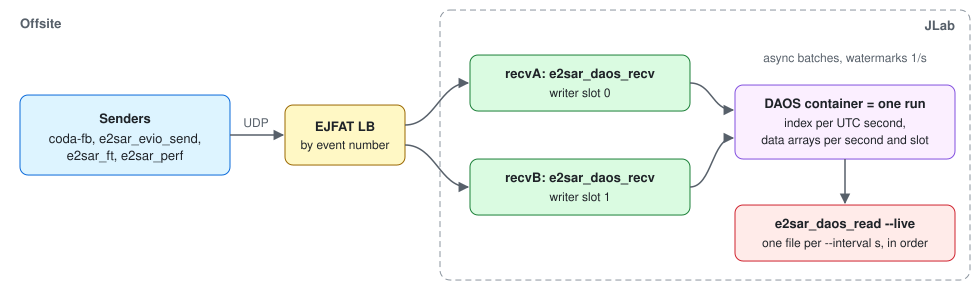
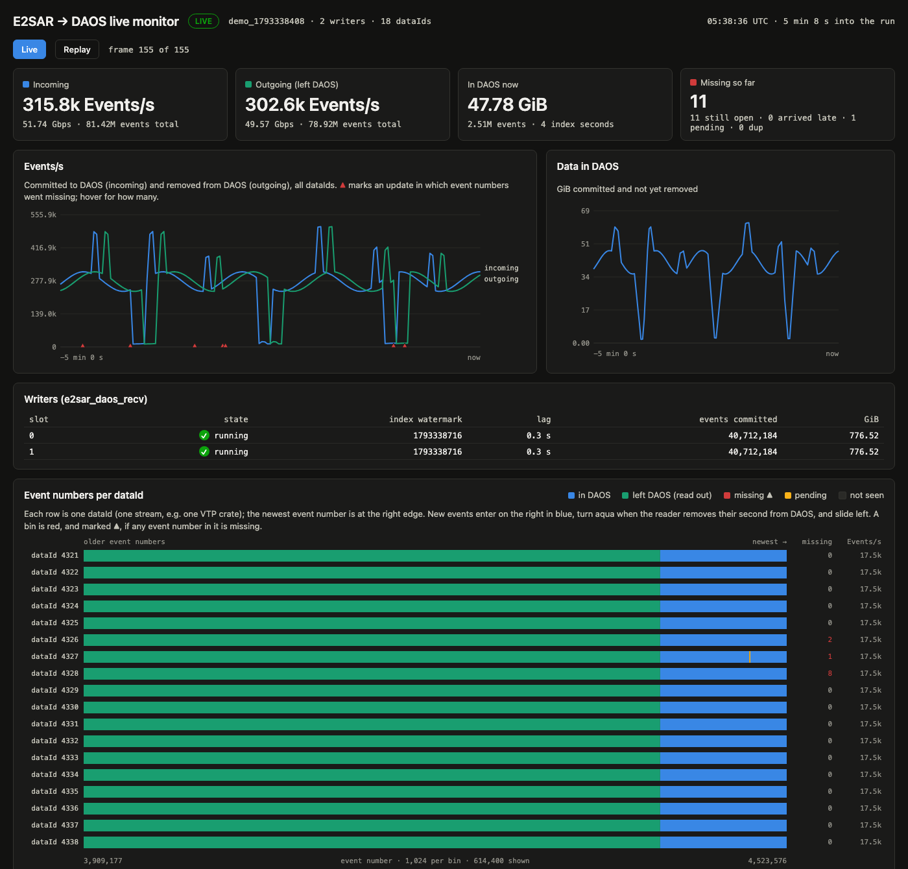
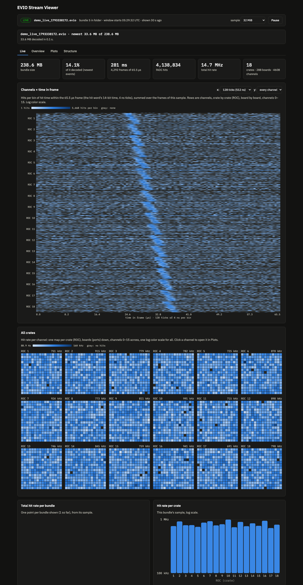

# Streaming workflow: senders → LB → DAOS → live reader

Implemented (2026-10-29): `e2sar_daos_recv` writes the layout of [daos-layout](daos-layout.md) and `e2sar_daos_read` reads it as in [e2sar_daos_read](../reference/e2sar_daos_read.md). This page covers the whole workflow, a [walkthrough](../howto/streaming-walkthrough.md#walkthrough---live-rm-streaming-of-an-evio-file) on the ebpf testbed, the two live monitors, the senders, and how the receiver settings will be tuned.
## The workflow

The receivers (DAOS writers) and the reader communicate only through the DAOS container: no sockets or shared files. The one rule outside the container is the order: receivers first, then the reader ([writer–reader contract](daos-layout.md#writerreader-contract)). The sequence:

1. **Receivers.** Start `e2sar_daos_recv` on recvA and recvB with the same `--cont-name`. The first creates the container and the run record; each claims a writer slot. With `--withcp` they register with the LB. Receivers must be up before the senders start, or the LB has nowhere to send.
2. **Reader.** Start `e2sar_daos_read --pool <pool> --cont <same name> -o DIR --live` (or `--live-rm` to remove data from DAOS as it reads; a mode is required, see [e2sar_daos_read](../reference/e2sar_daos_read.md)) on the reader node, after the receivers have started (the first one creates the container; a reader started before that exits with an error). It can start before the senders, during the run, or after it (it catches up).
3. **Senders.** Start sending. The LB sends every event number to one receiver.
4. **Monitors (optional).** `e2sar_daos_monitor` and the EVIO viewer in live mode, any time after step 1 (see [Monitoring](#monitoring)). They don't change what the receivers or the reader do.

While the run goes on:

- Each receiver batches small events and writes them asynchronously. A batch becomes visible when its index entry is written.
- Each receiver writes a watermark once a second. Second T is complete when every receiver's watermark is past T.
- The reader checks the container every second and writes one file `DIR/<run>_<W>.evio` per `--interval` window (default 5 s), its events glued back to back in `(evtNum, dataId)` order, about 1–3 s after the window ends. With `--live-rm` it removes objects from DAOS once they are `--rm-after` intervals (default 10) behind the last file written.

At the end: stop the senders, then the receivers (Ctrl-C). Each writes its final statistics (`done/<slot>`). The reader sees that in the container, writes the last bundles and exits once every receiver is done and no new one has appeared for `--end-wait` seconds.

### What the reader guarantees

| | |
|---|---|
| Complete windows | A bundle is written only after every receiver has committed everything for each second of its window |
| Order | Strict within a bundle. Across bundles close to event-number order; events that come out late are counted |
| Restart | The manifest's last bundle is the restart point. A bundle's content depends only on DAOS, so a rerun writes identical files |
| File transfers (`e2sar_ft`) | With `--offline` (after the transfer): one file per `(evtNum, dataId)`, byte for byte the sent file, with its SHA-256 printed; the run stays in DAOS until `--delete`. A file with any lost packet is dropped by E2SAR and only appears in `<run>_missing.txt` |
| Lost events | Gaps per `dataId` go to `<run>_missing.txt`. A receiver that dies is reported, and the reader continues without it after a timeout |

## Monitoring

Two independent tools show a run live, each in a web page. Neither writes to DAOS or to the reader's folder, and either can run without the other.

| | DAOS monitor | EVIO live viewer |
|---|---|---|
| Shows | The container: events coming in, events leaving DAOS, event numbers missing per `dataId` | The data: the newest bundle the reader wrote, decoded (hits per channel × time in frame, per-crate maps, rates) |
| Reads | The catalog and the index of the container, read-only | `-o DIR` of `e2sar_daos_read --live`/`--live-rm`: the newest `<run>_<W>.evio` and its `.idx` |
| Programs | [`e2sar_daos_monitor`](../reference/e2sar_daos_monitor.md) (C++) writes a JSON line per 2 s; [`viz/daos_monitor/serve.py`](../../viz/daos_monitor/serve.py) serves the page | `serve.py --live DIR` of [evio-interactive-view](https://code.jlab.org/xmei/evio-interactive-view) (branch `sc26-live-viz`) |
| Runs on | A DAOS client with access to the pool. The reader node is the natural place; not a receiver node, whose cores go to reassembly | The reader node, where the bundles are (or any node that mounts `-o DIR`) |
| Port | 8766 | 8765 |
| Load on the run | One read of each 32-byte index entry, one `seconds` listing per 2 s (estimated, not yet measured on DAOS) | None on DAOS. Reads at most the sample (default 32 MiB) of each bundle from the page cache |
| Load on the page | ~4 KB per update; the page draws one canvas and three small charts | The browser decodes the sample: ~4,300 frames of 18 crates per 32 MiB, under 1 s |

**What the DAOS monitor counts.** *Incoming*: events newly committed (index entries). *Outgoing*: events whose index second was removed from DAOS, by `--live-rm`; 0 with `--live`. *Missing*: event numbers absent for more than 5 s while a higher number of that `dataId` is committed, counted cumulatively (a late arrival doesn't lower it) and marked ▲ on the Events/s chart. The strip shows each `dataId`'s newest ~32 s of event numbers, moving left as new ones come in. **Replay** plays back the whole run from the JSON lines file.

**Bundle size for the viewer.** For the SC26 source (18 VTP crates, 12 or 16 fADC boards of 16 channels: 3,456–4,608 channels) at `--interval 2`, a bundle stays under 1 GiB while the total rate is under ~4 Gbps. That is about 25 kHz per channel with 16 boards per crate (35 kHz with 12), after ~60 MB/s of record and bank headers (15,259 frames/s × 18 crates × ~220 bytes). The viewer never decodes a whole bundle: it takes the newest events up to the sample size, cut at an event-number boundary, so its update time doesn't depend on the bundle size. Each event is one crate's time slice (`evtNum` = frame, `dataId` = crate) or one built frame (0xFF60); the viewer reads both.

**Viewing from a laptop.** Both pages listen on `127.0.0.1` only. Forward both ports through one SSH connection and open the two pages on the laptop: steps in [live-monitoring](../howto/live-monitoring.md).

## Senders

| Sender | Events | Event number | Status |
|---|---|---|---|
| coda-fb | One EVIO-6 record per built time frame (or per group of frames), ~20 KB expected | Frame number, one `dataId` |  |
| `e2sar_evio_send` | The frames of an EVIO file (`-F`): each record is one frame, sent as one event | 1…N per Segmenter, `dataId` 4321 + i | Works |
| `e2sar_ft` | One whole file per event (often GBs) | 0, 1, 2, … | Works |
| `e2sar_perf` | Synthetic events of `-l` bytes (1 MiB in the Perlmutter runs) | from 0 | Works |

### What streaming changes in the numbers

1. **Small records hit the event-rate ceiling.** The Reassembler handles ~85k events/s whatever the size. One real-time stream of ~426 B frames is ~15k frames/s, so records must hold many frames once there are several streams or a speedup.
2. **The largest record sets the loss.** Each record leaves the sender as one line-rate burst, and the receiver's port discards grow with burst size ([lossless-ceiling](lossless-ceiling.md#diagnosing-the-port-discards)). Smaller records keep the bursts small.
3. **Data age has new stages.** A 256-frame record waits ~16.8 ms in real time to fill, more than the 0.3–0.5 ms node-to-node pipeline. The batch flush (≤ `--flush-us`) and the reader's window (up to `--interval` + 1–3 s, default interval 5 s) come after the DAOS write.
4. **Through the LB, event numbers are LB ticks.** Records that start at different frames on each stream get unrelated ticks, so the same time slice of different streams can go to different receivers. That doesn't matter for storing, since the reader merges all receivers. It does matter for a later step that builds events across streams, which then needs common record boundaries.
