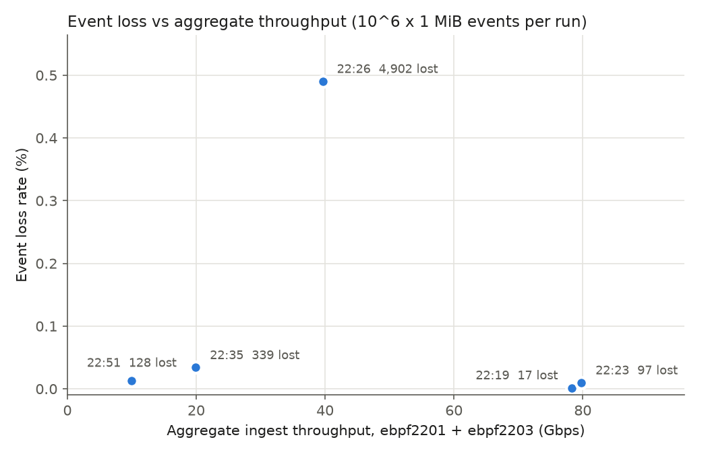
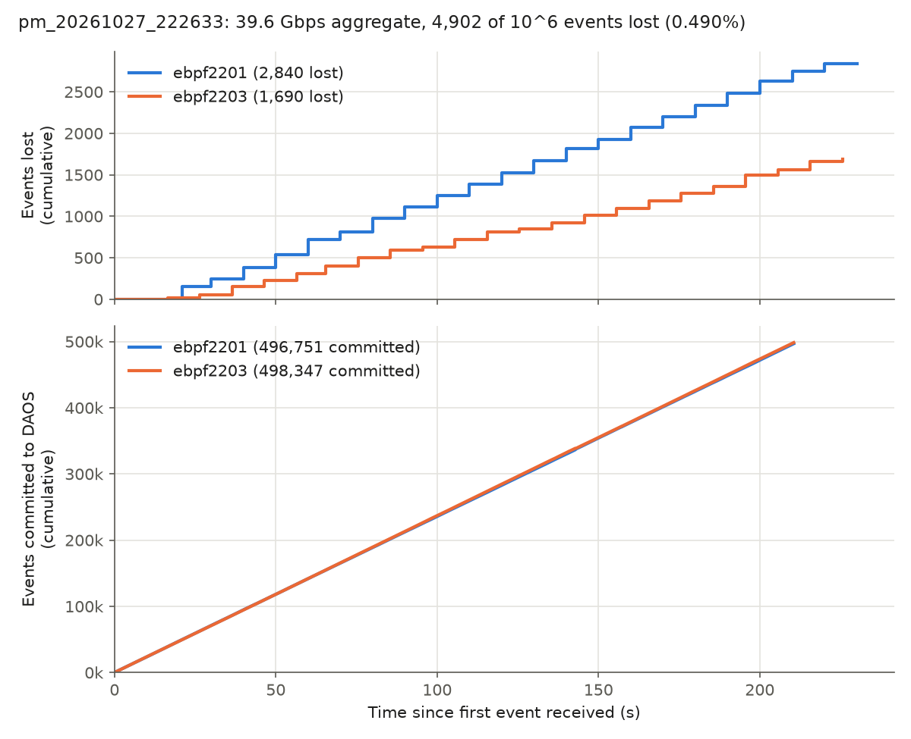
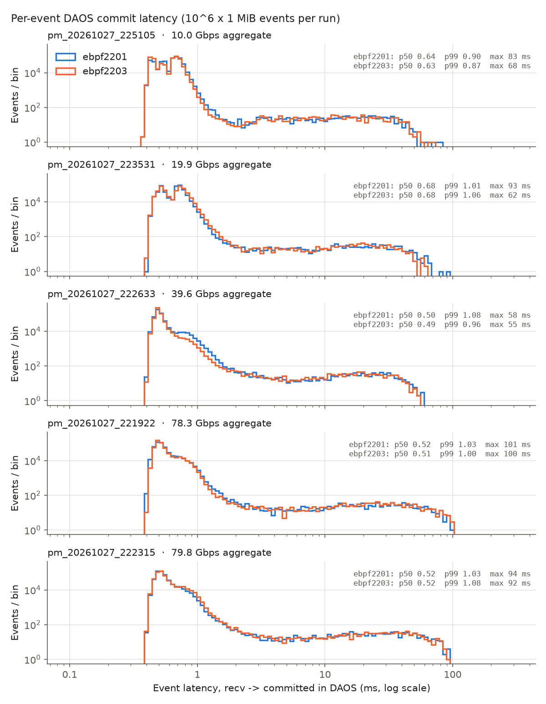
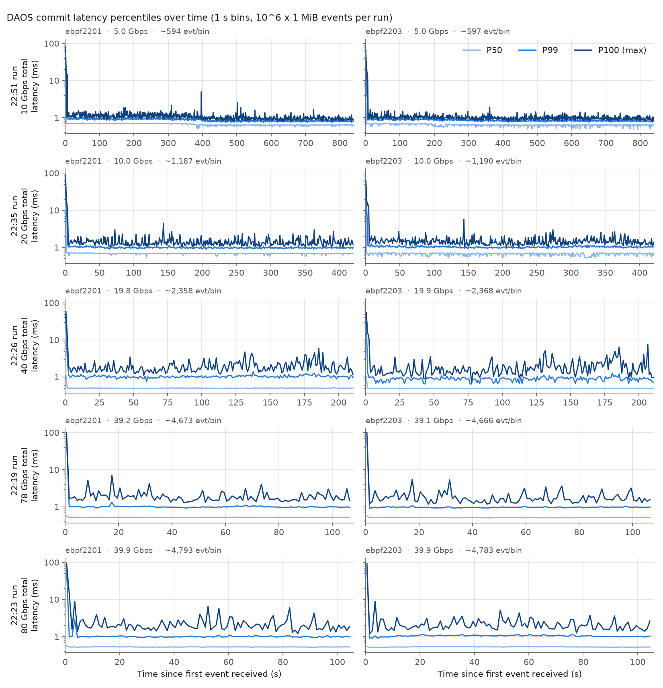

# Perlmutter → ESnet LB → two ebpf receivers into DAOS, 10–80 Gbps (2026-10-27)

The first data from Perlmutter through the ESnet EJFAT load balancer into DAOS at JLab. One Perlmutter CPU node sent 10⁶ synthetic events of 1 MiB per run with `e2sar_perf`; the LB split them between `e2sar_daos_recv` on ebpf2201 and on ebpf2203, which wrote every event into the same DAOS container. Five runs, from 80 Gbps down to 10 Gbps aggregate. Times below are US Eastern (EDT) as in the run names, with UTC alongside: 22:19 EDT on 2026-10-27 is 02:19 UTC on 2026-10-28.

These runs used **the old KV layout** (one `daos_kv_put` per 1 MiB chunk, container `sc26/e2sar-pm`, the run name as key prefix), before [the current layout](../concepts/daos-layout.md) of 2026-10-30.

## Summary

| Run (EDT) | Data (UTC, 10-28) | Aggregate rate | Per node (2201 / 2203) | Committed | Lost | Loss rate | of which reassembly (2201 + 2203) | never arrived |
|---|---|---|---|---|---|---|---|---|
| `pm_20261027_221922` | 02:20:10–02:21:57 | **78.32 Gbps** | 39.19 / 39.13 | 999,983 | **17** | **1.7×10⁻⁵** | 17 (12 + 5) | 0 |
| `pm_20261027_222315` | 02:23:26–02:25:12 | **79.79 Gbps** | 39.91 / 39.89 | 999,903 | **97** | **9.7×10⁻⁵** | 97 (10 + 87) | 0 |
| `pm_20261027_222633` | 02:27:07–02:30:37 | 39.65 Gbps | 19.79 / 19.86 | 995,098 | **4,902** | **4.9×10⁻³** (0.49%) | 4,530 (2,840 + 1,690) | 372 |
| `pm_20261027_223531` | 02:36:00–02:43:00 | 19.94 Gbps | 9.97 / 9.96 | 999,661 | 339 | 3.4×10⁻⁴ | 238 (71 + 167) | 101 |
| `pm_20261027_225105` | 02:51:21–03:05:21 | 9.99 Gbps | 5.00 / 5.00 | 999,872 | 128 | 1.3×10⁻⁴ | 78 (32 + 46) | 50 |

*Lost* = 10⁶ sent − committed. *Never arrived* = lost − reassembly loss: events of which no packet reached either receiver. In every run: enqueue loss 0, failed DAOS writes 0, `UdpRcvbufErrors` 0, `rx_out_of_buffer` 0, and the LB split the events evenly (49.96–50.04% per node).



## Setup

```
Perlmutter CPU node (NERSC)                ESnet LB (stable4)                        JLab
hsn0 128.55.x.x, MTU 9000                                               ebpf2201 129.57.178.85 ─▶ DAOS sc26/e2sar-pm
e2sar_perf -s --withcp ──UDP──▶ data plane 192.188.29.54 ──UDP──┬──────▶ e2sar_daos_recv :20600–20615
                                                                └──────▶ e2sar_daos_recv :20600–20615
                                                                        ebpf2203 129.57.178.86 ─▶ DAOS sc26/e2sar-pm
```

| | |
|---|---|
| Sender | one Perlmutter CPU node, `e2sar_perf -v -s --withcp --ip <hsn0 128.55.x.x> --mtu 9000 -l 1048576 -n 1000000 --rate <Gbps> --sockets <n> -b 67108864`, E2SAR 0.4.0rc1, as in the guide of that evening ([PERLMUTTER_GUIDE.md at 3fac98a](https://github.com/JeffersonLab/e2sar-daos/blob/3fac98a/docs/PERLMUTTER_GUIDE.md), now [lcf-slurm](../sites/lcf-slurm.md)). The node name, `--rate` and `--sockets` of each run were not kept: only the receivers' side is recorded |
| Load balancer | an ESnet LB instance on stable4 (control plane `192.188.29.6:18048`, data plane `192.188.29.54`); two workers, one per ebpf node |
| Receivers | `e2sar_daos_recv --withcp` on each node through `bin/e2sar_pm_recv.sh` (now `scripts/e2sar_site2ebpf_recv.sh`): 16 receive threads on ports 20600–20615, 32 dequeue threads × 256 puts in flight, 1 GiB socket buffer (`-b 1073741824`), 1 MiB chunks, 500 ms reassembly timeout |
| DAOS | pool `sc26`, container `e2sar-pm`, the old KV layout; E2SAR 0.4.0rc1, DAOS 2.6.5 |
| Receiver hosts | ebpf2201, ebpf2203: 2 × AMD EPYC 7763, data port `enp1s0f1np1` mlx5 100 Gb/s, MTU 9000 |
| Packets | ~59.0M per node per run (`rx_packets_phy`), ~118 per 1 MiB event: ~8.9 KB jumbo frames |

Before the five runs, three shorter ones checked the path (same settings): `pm_20261027_215642` (10,000 events at ~20 Gbps: 2 lost), `pm_20261027_220714` (100,000 events at ~20 Gbps: 50 lost) and `pm_20261027_221223` (100,000 events at ~80 Gbps: 16 lost).

## Losses

### NIC counters per run

| Run | Rate | `rx_discards_phy` 2201 / 2203 | Reassembly loss 2201 / 2203 | When the loss happened |
|---|---|---|---|---|
| `…221922` | 78.3 | 129 / 26 | 12 / 5 | one step each, 14–18 s after the first event |
| `…222315` | 79.8 | 103 / **942** | 10 / **87** | one step each, 14–19 s after the first event |
| `…222633` | 39.6 | **22,531 / 14,227** | **2,840 / 1,690** | steps every ~10 s, the whole run (22 steps on each node) |
| `…223531` | 19.9 | 348 / 966 | 71 / 167 | steps every ~10 s, the whole run |
| `…225105` | 10.0 | 123 / 251 | 32 / 46 | small steps every ~10–40 s, the whole run |

`rx_out_of_buffer` and `UdpRcvbufErrors` were 0 in every run, on both nodes: the NIC's ring and the sockets never overflowed. Every reassembly loss came with NIC port discards (`rx_discards_phy`) on the same node: the port's buffer overflowed before packets reached host memory.



What this says:

1. **80 Gbps aggregate (40 Gbps per node) is the cleanest rate here.** Both runs lost under 10⁻⁴, all of it in one burst per node ~15 s into the run and none after, and every event that left Perlmutter arrived at least in part.
2. **The 40 Gbps run is the outlier: 0.49% lost**, ~50× the 80 Gbps runs, with 14k–23k NIC port discards per node. Its loss is not a start-up burst but a step every ~10 s on both nodes for the whole 210 s.
3. **10 and 20 Gbps lost in the same ~10 s steps**, much smaller: 128 and 339 events.
4. **Lower rates also lost whole events** (372, 101 and 50 events of which no packet arrived at either node), the 80 Gbps runs none. With the sender's settings not kept, this can't be placed on the sender, Perlmutter's egress, the WAN or the LB.

The ~10 s period at 10–40 Gbps, on both nodes at once, points to something periodic outside the receivers rather than to load (the receivers lose more at 20 Gbps per node than at 40). Candidates not checked: the sender's pacing at `--rate` below its line rate with a given `--sockets` (1 MiB events leave each send thread as line-rate bursts), and periodic work on the sender, the LB or the path. For comparison, ebpf2201 → LB → ebpf2203 with `e2sar_perf` at both ends lost 0.02–0.04% at 80 Gbps ([2026-10-26-e2sar-perf-n2n-vs-lb](2026-10-26-e2sar-perf-n2n-vs-lb.md)), mostly at start-up.

## Latency: receive → committed in DAOS

| Run | Rate | p50 (ms) | p90 | p99 | p99.9 | p99.99 | max | events > 10 ms (2201 / 2203) |
|---|---|---|---|---|---|---|---|---|
| `…225105` | 10.0 | 0.64 / 0.63 | 0.75 / 0.74 | 0.90 / 0.87 | 12.2 / 11.4 | 37.8 / 37.8 | 83 / 68 | 567 / 550 |
| `…223531` | 19.9 | 0.68 / 0.68 | 0.80 / 0.83 | 1.01 / 1.06 | 14.1 / 14.8 | 45.2 / 39.9 | 93 / 62 | 639 / 641 |
| `…222633` | 39.6 | 0.50 / 0.49 | 0.68 / 0.57 | 1.08 / 0.96 | 15.9 / 15.0 | 39.6 / 37.7 | 58 / 55 | 683 / 683 |
| `…221922` | 78.3 | 0.52 / 0.51 | 0.73 / 0.73 | 1.03 / 1.00 | 21.0 / 22.9 | 67.6 / 69.5 | 101 / 100 | 784 / 829 |
| `…222315` | 79.8 | 0.52 / 0.52 | 0.71 / 0.76 | 1.03 / 1.08 | 22.2 / 24.2 | 66.6 / 64.4 | 94 / 92 | 820 / 823 |

Values are ebpf2201 / ebpf2203. This is the time from the last packet of an event at the receiver to its commit in DAOS (the old KV layout's puts), not the WAN: the sender's clock is not compared. p50 stays at 0.5–0.7 ms and p99 at ~1 ms at every rate; the tail above 10 ms is the first 3 s of each run (all but 0–9 of the 550–829 such events per node), when the first puts go out (up to ~100 ms); after that the maximum stays under ~10 ms.





## Kept

| What | Where |
|---|---|
| Receiver logs, per-event CSV (`evt_num, data_id, bytes, chunks, thread, recv_s, commit_s, latency_ms`), NIC snapshots and diffs, `nstat`, run ids | `~/e2sar_run/pm/pm_20261027_*/` (shared `$HOME` on the ebpf nodes), including the three short runs before |
| Summary table, latency percentiles, plots and their scripts | the laptop, `~/Documents/DAQ/pm-bench/` (`summary.csv`, `latency_pct.csv`, `plot_pm_bench.py`, `plot_latency.py`, `plot_latency_timeline.py`) |
| DAOS data | container `e2sar-pm` in pool `sc26` (the old KV layout); sc26 has been abandoned since 2026-11-11 ([2026-11-11-tb-nodes-fetch](2026-11-11-tb-nodes-fetch.md)) |

## Open items

1. Find the ~10 s period of the loss at 10–40 Gbps: repeat with the sender's `--rate`, `--sockets` and node recorded, with `e2sar_nicmon.sh` (1 s samples) on both receivers, and the same rate twice.
2. Rerun 40 Gbps aggregate: the one run lost 50× more than either 80 Gbps run.
3. Above 80 Gbps: the receivers had no ring or socket drops at 40 Gbps per node; the [lcf-slurm](../sites/lcf-slurm.md#10-rate-sweep-optional) rate sweep table is still to be filled with runs on the current layout.
