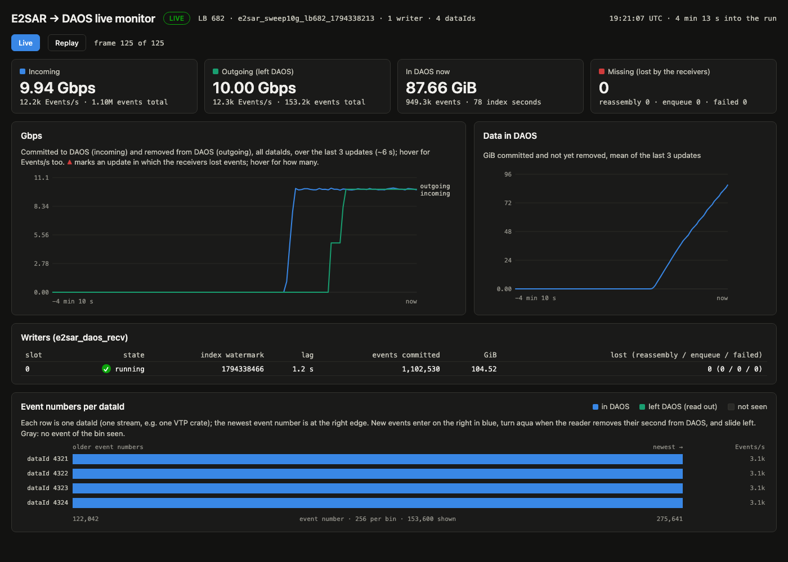

# LB 682 rate sweep, with and without a sender ramp (2026-11-10)

Two sweeps of the same sender at 20, 15, 10 and 5 Gbps, 90 s each, through LB 682 into one `e2sar_daos_recv` on ebpf2201. The second sweep differs only in `e2sar_evio_send --ramp 10`: the rate starts at 1 Gbps and rises linearly to the target over the first 10 s.

## Setup

| | |
|---|---|
| Sender | ebpf2203 (129.57.178.86): `e2sar_evio_send -c -v -P 4 -s 4 -f 250 -r <rate> -n <events>`, second sweep with `--ramp 10`. File `frames_thread0_file0020.evio`: 4,362,277 frames of 407 B mean; 250 frames per event make 17,450 distinct events of 101,794 B mean, repeated to fill 90 s. 4 streams (dataId 4321–4324), 4 sockets each, MTU 9000 (~12 packets per event) |
| LB | LB 682, the instance URI in `~/e2sar-instance.env`. Each sender adds itself to the sender list (`-c`) and removes itself at the end |
| Receiver | ebpf2201 (129.57.178.85): `e2sar_daos_recv -c --threads 4 --deq 16 -b 1073741824` into pool `sc26`, a fresh container per run, started by `scripts/e2sar_live_pipeline.sh` (`RECV=ebpf2201… READER=ebpf2201`) |
| Same node | `e2sar_daos_read --live-rm --interval 2 --rm-after 2`, `e2sar_daos_monitor`, the monitor page and the EVIO viewer |
| Counted | *Missing* = events sent (sender's `Sent:`) − events committed (receiver's `Events committed:`). *Reassembly*: the receiver's reassembly loss. *NIC port drops*: `rx_discards_phy` over the run, from `e2sar_nicmon.sh` (1 s samples) |

## Results

| Sender rate (90 s each) | Sent | Missing, no ramp | Missing, `--ramp 10` | NIC port drops, no ramp | NIC port drops, `--ramp 10` |
|---|---|---|---|---|---|
| 20 Gbps | 2,210,344 | 101 (0.0046%) | 3 (0.00014%) | 448 packets | 8 |
| 15 Gbps | 1,657,756 | 21 (0.0013%) | **0** | 72 | 0 |
| 10 Gbps | 1,105,172 | **0** | 0 | 0 | 0 |
| 5 Gbps | 552,584 | 0 | 0 | 0 | 0 |

- **Fastest lossless rate:** 10 Gbps without the ramp, 15 Gbps with it.
- Of the missing, all but 5 (20 Gbps, no ramp: never arrived) were reassembly losses: an event with at least one packet missing. No enqueue loss and no failed DAOS write in any run.
- **Every loss lines up with NIC port discards** (`rx_discards_phy`): the NIC dropped the packets before the host saw them. `rx_out_of_buffer`, `Udp.RcvbufErrors`, `Udp.InErrors` and `softnet.dropped` stayed at 0, so the 1 GiB socket buffer and the receive rings kept up.

**When the losses happened**, from the first data (the receiver's 10 s reports):

| Rate | No ramp | `--ramp 10` |
|---|---|---|
| 20 Gbps | 64 in the first 10 s, 32 at 70–80 s, and 5 never arrived | none in the first 10 s; 3 at ~20 s, after the ramp reached 20 Gbps |
| 15 Gbps | 14 in the first 10 s, 7 at 11–20 s | none |

## What it shows

- **The start-up burst is a cold receiver.** Hit at full rate from the first event, the receiver lost events in its first seconds at every rate from 15 Gbps up; started at 1 Gbps and raised over 10 s, it lost none there. This matches the [summary](e2e-summary.md): node to node, almost all lost events were queued in the first 0.1 s, while the receiver's first DAOS writes are slow.
- **A ramp only helps a test.** Real senders (CODA, an LCF frame builder) start at full rate. The fix for them is in the receiver: warm it up (open the objects, a first DAOS write) before it registers with the LB.
- **After the start, 20 Gbps still loses a little** (32 without the ramp, 3 with it, one run each). Whether the ramp also lowers these, or this is run-to-run spread, needs repeated runs.

## Also measured today

- **Small events, unlimited.** One frame per event (407 B, one packet each), `-r -1`: the sender sent 80M events at 2.1 Gbps (640k events/s); the receiver took ~290k events/s at most (0.94 Gbps) and stored 36.3M (45%). With events this small the packet rate limits one receiver, not the bandwidth. Hence `-f 250` above.
- **A 7-minute run at 20 Gbps, no ramp:** 10,000,000 sent, 9,999,362 stored, 638 missing (636 reassembly), 2,015 NIC port drops. 77 were lost in the first seconds; later bursts came every 30–90 s and closer together after ~4.5 min, as DAOS held ~600 GB waiting for the reader.
- **The `--live-rm` reader writes ~2.2 Gbps** on ebpf2201, whatever `--interval` is: 2 s windows took ~17.5 s each (4.7 GB), 1 s windows ~9.5 s (2.4 GB). Above that rate data waits in DAOS (*In DAOS* grows on the monitor page) and *Outgoing* comes in steps, one window at a time. Outgoing counts seconds of data removed, so it can show the incoming rate while the reader falls behind.

## Open

- Repeat each rate a few times, and try 17.5 Gbps with the ramp.
- Warm up `e2sar_daos_recv` before it registers with the LB, then rerun without a ramp.
- Move the reader, monitor and pages off the receiver node, to see if the later bursts at 20 Gbps go away.
- What limits the reader at ~2.2 Gbps: `/scratch`, or reading from DAOS.

The runs' data and logs were deleted after this analysis; the numbers above are from the receiver and sender logs and the 1 s NIC samples (`e2sar_nicmon.sh`).
