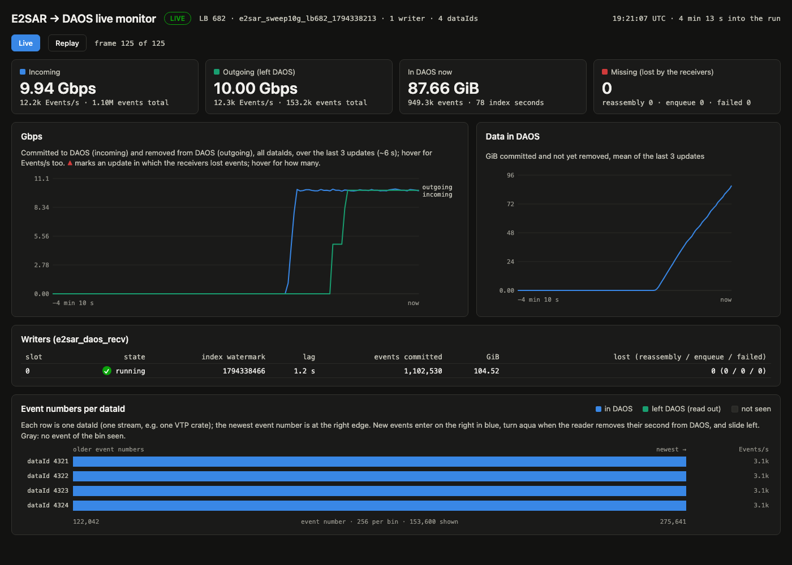

# LB 686 into sc-demo with two receivers, stopped at 10 TB (2026-11-12 04:53:34–05:57:43 UTC)

Run `e2sar_lb686_1794459212`. The sender on LB 686 came back at ~21 Gbps with ~171 KB events, 6–7× the rate of the [previous LB 686 run](2026-11-12-004630UTC-lb686-live-rm.md). Two receivers took it, `e2sar_daos_recv` on ebpf2201 (worker 1) and on ebpf2203 (worker 2), each with 16 receive threads. No reader ran: everything stayed in DAOS. The run was stopped by hand once the two receivers had committed 10 TB, with 1.6 TB left in the pool. The sender side is not ours: its commands and settings are not known here.

## Summary

| | |
|---|---|
| Data | 04:53:34.7 to 05:57:43 UTC (receive window 3,848.3 s = 64.1 min), one stream (`dataId` 1) |
| Events | **58,774,967** received and committed (worker 1: 29,392,040, worker 2: 29,382,927), **10,056,065,757,268 bytes** (10.06 TB, 9.15 TiB) |
| Event size | mean 171,095 bytes; ~119.7 UDP packets per event, ~1.43 KB of payload per packet |
| Rate | **20.90 Gbps**, 15,272.6 events/s (worker 1: 10.454 Gbps, worker 2: 10.450 Gbps); ~914k packets/s per node |
| Receivers | DAOS failures 0, lost in enqueue 0, **lost in reassembly 1,619** (worker 1: 936, worker 2: 683), loss rate **2.75×10⁻⁵** |
| Latency (receive → commit) | p50 4.19 ms, p99 6.82 ms, max 43.0 / 52.5 ms (worker 1 / 2) |
| NIC and kernel drops | `rx_discards_phy` 9,354 / 4,446 packets; `rx_out_of_buffer`, `softnet.dropped`, `Udp.RcvbufErrors`, `Udp.InErrors`, `Udp.NoPorts` all 0 on both |
| Loss by cause | of the 1,597 matched: NIC port discard 58%, upstream (no counter change) 36%, kernel IP→UDP drop 5%, missing (no counter change) 6 events |
| DAOS | all 10.06 TB kept; sc-demo NVMe free 12 TB → 1.6 TB |


The plot counts up to each receiver's last 10 s progress line (1,597 lost of 58.67M events). The final 22 losses came after that, in the last seconds and the drain, and have no cause assigned.

## The workflow

```
external sender(s) ──UDP, ~1.43 KB packets──▶ LB 686 (ESnet, 512 slots) ─┬─▶ ebpf2201 e2sar_daos_recv (worker 1, writer slot 0, 16 ports, 256 slots)
                                                                          └─▶ ebpf2203 e2sar_daos_recv (worker 2, writer slot 1, 16 ports, 256 slots)
                                                                                      │ async array writes
                                                                                      ▼
                                                  DAOS pool sc-demo (daosfs2301, 32 targets) ─ container e2sar_lb686_1794459212
                                                                                      │ e2sar_daos_monitor (2 s ticks, on ebpf2201) ─▶ monitor page :8766
                                                                                      ✕ no reader
```

| Stage | Node | Command / setting |
|---|---|---|
| Sender | not ours | 129.57.177.19 and 198.124.49.31, both registered on LB 686 before and after the run |
| Load balancer | ESnet `ejfat-lb.es.net:18008`, LB 686 | reserved until 2027-11-11; two workers, 256 slots each. URI and token in the private `~/e2sar-lb686.env`, never in the repo |
| Receivers | ebpf2201, ebpf2203 | `e2sar_daos_recv -c --ip <data IP> --port 20700 --pool sc-demo --cont-name <run> --threads 16 --deq 16 --report 10 --log-idle -b 1073741824` |
| NIC samplers | both | `scripts/e2sar_nicmon.sh`, once a second, 3,744 / 3,737 samples |
| DAOS monitor | ebpf2201 | `e2sar_daos_monitor --pool sc-demo --cont <run> -o /scratch/xmei/<run>_monitor.jsonl` (1,904 ticks of 2 s) + `viz/daos_monitor/serve.py --port 8766` |
| Driver | laptop | started by hand with the same commands as `scripts/e2sar_live_pipeline.sh start` minus the reader and the EVIO viewer (the script always starts a reader); `~/e2sar_run/lb686/current` set so that `e2sar_live_pipeline.sh stop` (`RECV="ebpf2201:129.57.178.85 ebpf2203:129.57.178.86" READER=ebpf2201 LOGDIR=e2sar_run/lb686`) stops it. A laptop loop read both receivers' committed bytes every 15 s and ran `stop` at ≥ 10 TB |



### Software and hosts

| | ebpf2201 (worker 1) | ebpf2203 (worker 2) |
|---|---|---|
| CPU, memory | 2 × AMD EPYC 7763 (128 cores), 503 GB | the same |
| OS | AlmaLinux 9.8, kernel 5.14.0-687.56.1 | kernel 5.14.0-687.57.1 |
| Data port | `enp1s0f1np1`, mlx5, 100 Gb/s, MTU 9000, RX ring 8192, 129.57.178.85 | the same, 129.57.178.86 |
| Socket buffers | `rmem_max` 2147483647; 16 receive sockets, 1 GiB asked | the same |

E2SAR 0.4.0rc1, DAOS client 2.6.5, e2sar-daos at `bb21b13`. Container: `rd_fac` 0, classes data `SX`, index `S8`, catalog `S1` (the defaults, [daos-layout](../concepts/daos-layout.md)).

## Timeline (UTC, 2026-11-12)

| Time | |
|---|---|
| 04:53:32 | run started; worker 1 creates the container and listens at 04:53:34, worker 2 joins and listens at 04:53:37; the LB gives each 256 slots |
| 04:53:35–04:53:38 | worker 1 takes 1.5–1.9M packets/s for 3 s (twice the steady rate) as the LB moves slots; the first NIC port discards on both nodes |
| 04:57:58 | worker 1: 69,343 packets taken in at IP and not handed to UDP within one second |
| 05:11:39–05:11:49 | worker 2: the same, ~81,100 packets |
| 05:27:56 | worker 1: the same, 76,043 packets |
| 05:28–05:38 | the largest NIC discard bursts on worker 1: up to 852 packets (05:33:26) and up to 94 lost events (05:37:46) in 10 s |
| 05:41:40 | worker 2: IP→UDP drop, 79,413 packets |
| 05:45–05:57 | most loss now upstream (197 of 276 events): both workers lose events in the same 10 s with no counter change |
| 05:57:40 | the laptop loop sees 10.024 TB committed and runs `stop` |
| 05:57:42–05:57:49 | both receivers deregister and drain (2,551 and 7,239 events after Ctrl-C), write their final statistics; NIC samplers and the monitor stop |

## Losses: matching each one with the host counters

Every receiver prints its counters every 10 s; `e2sar_nicmon.sh` samples the node's NIC (`ethtool -S`), IP, UDP and softnet counters every second. For each 10 s interval in which a worker's reassembly loss rose, [`scripts/e2sar_loss_timeline.py`](../../scripts/e2sar_loss_timeline.py) sums that node's counters over the same interval plus 1 s before it (for the 500 ms reassembly timeout) and names the cause:

| Cause | How it is decided | Worker 1 | Worker 2 | Total |
|---|---|---|---|---|
| **NIC port discard** | `rx_discards_phy` rose: the port's buffer in the NIC overflowed before the packet reached a ring | 694 | 239 | **933 (58%)** |
| **Upstream (no counter change)** | no drop counter rose on this node, and the other worker lost events within 10 s too: the packets most likely never reached either node | 197 | 384 | **581 (36%)** |
| **Kernel IP→UDP drop** | `Ip.InReceives − Ip.InDelivers` > 2,000 in the interval: the kernel took the packets in at IP and never handed them to UDP, and no drop counter rose | 36 | 41 | **77 (5%)** |
| **Missing (no counter change)** | no drop counter rose, and only this worker lost events | 2 | 4 | **6** |
| NIC ring full, softnet backlog, socket buffer full | `rx_out_of_buffer`, `softnet.dropped`, `Udp.RcvbufErrors` | 0 | 0 | 0 |
| after the last progress line, and in the drain | not matched | 7 | 15 | 22 |
| **All** | | **936** | **683** | **1,619** (2.75×10⁻⁵ of 58,776,586) |

A lost event needs at least one lost packet, so a counter that rose by *n* packets explains at most *n* of the interval's lost events; the rest count as upstream or missing. Example: at 05:28:50 worker 2 lost 49 events while `rx_discards_phy` rose by 2, so 2 are NIC port discards and 47 upstream (worker 1 lost 94 at the same time). A cause means *the counter moved in the same interval*, a strong match but not a proof. Every lost event here is a reassembly loss: some of its ~120 packets arrived, at least one did not.

What this says:

1. **The receivers keep up.** No socket buffer, NIC ring or softnet drop on either node in 64 min at 10.45 Gbps each; enqueue loss and DAOS failures are 0, and receive → commit stays under 7 ms at p99. More threads or larger buffers would not have saved any of these events.
2. **NIC port discards are the largest cause, and twice as frequent on ebpf2201** (9,354 packets against 4,446 under the same load). They come in bursts (up to 852 packets in 10 s) and are the same counter that set the ~25 Gbps ceiling on ebpf2203 with LB 638 ([2026-10-19-lb-e2sar-ft](2026-10-19-lb-e2sar-ft.md)). With an average of ~10 Gbps on a 100 Gb/s port, they point to bursts arriving faster than the NIC moves packets to host memory, not to a lack of throughput.
3. **A third of the loss is upstream**, and its share grew toward the end (197 of the 276 events lost in 05:45–05:57). Both nodes see it in the same seconds with clean counters, so it happens at the sender, the LB or on the WAN.
4. **The kernel IP→UDP drop happened 4 times**, 69k–81k packets each, in under a second, with no counter: the same signature as the 23,076 packets at 00:57:54 in the [previous run](2026-11-12-004630UTC-lb686-live-rm.md). It is only 5% of the loss but is the one cause not yet understood.

### Totals per node over the run (`e2sar_nicmon.sh`)

| Counter | ebpf2201 | ebpf2203 |
|---|---|---|
| `rx_packets_phy` | 3,517,019,675 | 3,515,824,004 |
| `Udp.InDatagrams` | 3,516,692,294 | 3,515,590,951 |
| `Tcp.InSegs` (NFS `$HOME`, SSH) | 233,251 | 106,562 |
| `rx_discards_phy` | 9,354 | 4,446 |
| `Ip.InReceives − Ip.InDelivers` | 145,372 | 160,518 |
| `rx_steer_missed_packets` | 2,208 | 2,212 (~0.6/s, steady on both nodes, not tied to the loss intervals) |
| `rx_out_of_buffer`, `softnet.dropped`, `Udp.RcvbufErrors`, `Udp.InErrors`, `Udp.NoPorts` | 0 | 0 |

### Drawing the plot

```
# the logs that e2sar_live_pipeline.sh stop leaves in ~/e2sar_run/lb686/<run>/, copied to the laptop
scripts/e2sar_loss_timeline.py e2sar_lb686_1794459212 loss.png \
    recv_ebpf2201.log nic_ebpf2201.log recv_ebpf2203.log nic_ebpf2203.log
```

Each `recv`/`nic` pair is one worker, in the order given. Bars: lost events per minute per worker (worker 1 plain, worker 2 hatched), stacked and colored by cause. Line: the cumulative loss rate of all workers, lost / (received + lost), on the right axis scaled by a power of ten. It also prints every matched interval with its counters. Needs numpy and matplotlib (the laptop; not on the ebpf nodes).

## Kept

The DAOS container `e2sar_lb686_1794459212` (10.06 TB, 58,774,967 events) was destroyed on 2026-11-12 at 19:37 UTC, to free sc-demo for the next run. The logs and the monitor JSON lines are kept:

| What | Where |
|---|---|
| Logs: receivers, monitor, page, NIC samples and before/after snapshots | `~/e2sar_run/lb686/e2sar_lb686_1794459212/` (shared `$HOME` on the ebpf nodes) |
| Monitor JSON lines (replay with [replay-run](../howto/replay-run.md)) | ebpf2201 `/scratch/xmei/e2sar_lb686_1794459212_monitor.jsonl` |
| Loss table, every matched interval | laptop `~/Documents/DAQ/workflow-runs/e2sar_lb686_1794459212_loss_table.txt` |

## Open items

1. Place the kernel IP→UDP drops: trace `skb:kfree_skb` drop reasons (or `drop_monitor`) on both nodes during the next run; check the firewall (`nft`) counters.
2. Why ebpf2201 discards twice as many packets as ebpf2203 at the same rate: compare NIC firmware, PCIe link, NUMA placement of the receive threads, and `rx_discards_phy` with the receive threads pinned (`--cores`).
3. The upstream loss: compare with the sender side's logs, and with the LB's per-worker counters.
4. Event-number gaps (events that never arrived at all) are not counted without a reader; read the container back with `e2sar_daos_read` to get them.
5. The sender splits ~171 KB events into ~120 packets of ~1.43 KB although both ports have MTU 9000; larger packets would cut the packet rate (~914k/s per node) by ~6× and likely the NIC discards with it.
