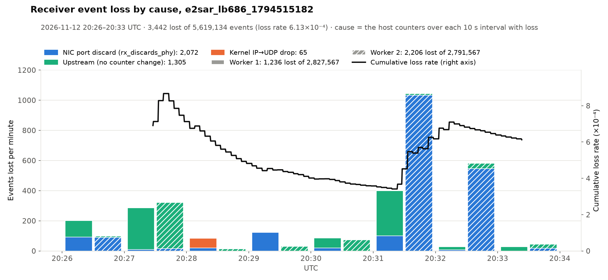

# LB 686 at 40.8 Gbps into sc-demo with two receivers, stopped at 10 TB (2026-11-12 20:37:25–21:10:35 UTC)

Run `e2sar_lb686_1794515844`. The senders on LB 686 came back at about 41 Gbps, twice the rate of the [morning's 10 TB run](2026-11-12-045334UTC-lb686-two-workers-10tb.md), with events twice as large (~381 KB). Two receivers took it, `e2sar_daos_recv` on ebpf2201 (worker 1) and ebpf2203 (worker 2), sized for up to 40 Gbps each: 32 receive threads and 16 DAOS dequeue threads per node. No reader ran. A guard on each node stopped its receiver once the two together had committed 10 TB. The sender side is not ours: its commands and settings are not known here.

Two shorter runs just before it, both on LB 686 with the same two nodes, tested the receiver settings: [a 45 Gbps run with 32 DAOS threads](#the-45-gbps-run-before-it) and [a run with the receive threads pinned to NUMA 0](#pinning-the-receive-threads-to-numa-0-makes-it-worse).

## Summary

| | |
|---|---|
| Data | 20:37:27 to 21:10:35 UTC (receive windows 1,976.2 s and 1,981.4 s, ~33 min), one stream (`dataId` 1) |
| Events | **26,532,389** received and committed (worker 1: 13,220,144, worker 2: 13,312,245), **10,100,320,318,228 bytes** (10.10 TB, 9.19 TiB) |
| Event size | mean 380,680 bytes; ~266 UDP packets per event, ~1.43 KB of payload per packet |
| Rate | **40.83 Gbps**, 13,408 events/s (worker 1: 20.372 Gbps, worker 2: 20.462 Gbps); ~1.75M packets/s per node, peaks 3.5–3.9M/s |
| Receivers | DAOS failures 0, lost in enqueue 0, **lost in reassembly 29,008** (worker 1: 24,639, worker 2: 4,369), loss rate **1.09×10⁻³** |
| Latency (receive → commit) | p50 3.15 ms, p99 7.34 ms, max 181 / 190 ms (worker 1 / 2); `daos_array_write` p50 0.39 ms, p99 1.97 / 1.84 ms |
| NIC and kernel drops | `rx_discards_phy` **376,850** / **776** packets; `rx_out_of_buffer`, `softnet.dropped`, `Udp.RcvbufErrors`, `Udp.InErrors` all 0 on both |
| Loss by cause | of the 28,996 matched: NIC port discard **79%** (22,833), upstream (no counter change) 21% (5,981), kernel IP→UDP drop 0.6% (182) |
| DAOS | all 10.10 TB kept; sc-demo NVMe free 12 TB → 1.6 TB |


The plot counts up to each receiver's last 10 s progress line (28,996 lost of 26.53M events). The last 12 losses, all on worker 1, came after that line and have no cause assigned.

## The workflow

```
external senders ──UDP, ~1.43 KB packets──▶ LB 686 (ESnet, 512 slots) ─┬─▶ ebpf2201 e2sar_daos_recv (worker 1, writer slot 0, 32 ports, 256 slots)
                                                                        └─▶ ebpf2203 e2sar_daos_recv (worker 2, writer slot 1, 32 ports, 256 slots)
                                                                                    │ async array writes, 16 DAOS threads per node
                                                                                    ▼
                                                DAOS pool sc-demo (daosfs2301) ─ container e2sar_lb686_1794515844
                                                                                    │ e2sar_daos_monitor (2 s ticks, on ebpf2201) ─▶ monitor page
                                                                                    ✕ no reader
```

| Stage | Node | Command / setting |
|---|---|---|
| Senders | not ours | 129.57.177.19, 198.124.49.31 and (new since the morning) 198.124.49.32 registered on LB 686 |
| Load balancer | ESnet `ejfat-lb.es.net:18008`, LB 686 | two workers, 256 slots each. URI and token in the private `~/e2sar-lb686.env`, never in the repo |
| Receivers | ebpf2201, ebpf2203 | `e2sar_daos_recv -c --ip <data IP> --port 20700 --pool sc-demo --cont-name <run> --threads 32 --deq 16 --inflight 128 -b 1073741824 --report 10 --log-idle` |
| NIC samplers | both | `scripts/e2sar_nicmon.sh`, once a second, 1,944 / 1,938 samples |
| DAOS monitor | ebpf2201 | `e2sar_daos_monitor --pool sc-demo --cont <run> -o /scratch/xmei/<run>_monitor.jsonl` (989 ticks of 2 s) + `viz/daos_monitor/serve.py` |
| Stop at 10 TB | both | a shell loop on each node read both receivers' committed MiB from their logs (shared `$HOME`) every 10 s and sent Ctrl-C to its own receiver at ≥ 10 TB, or at < 0.8 TB free in the pool. One per node, because ebpf2201 can't SSH to ebpf2203 without a password, so `e2sar_live_pipeline.sh stop` can't be run from a node |

`--threads 32` instead of the morning's 16 gives each node 32 receive sockets, one per port 20700–20731, so the LB's entropy spreads the packets over more ports and RX queues. All 32 receive threads show ~100% CPU, but that is E2SAR polling its sockets: the socket queues held 0.5–1 MB against the 1 GiB buffers, and `Udp.RcvbufErrors` stayed 0. `--numa 0` was not used: this E2SAR build has no NUMA support ("NUMA management not available on this system").


### Software and hosts

Same hosts and software as the [morning run](2026-11-12-045334UTC-lb686-two-workers-10tb.md#software-and-hosts): 2 × AMD EPYC 7763 (128 cores, 2 NUMA nodes), `enp1s0f1np1` mlx5 100 Gb/s on NUMA node 0, MTU 9000, RX ring 8192 (the maximum), 63 combined channels with one completion IRQ on each NUMA 0 core; `rmem_max` 2147483647, `netdev_max_backlog` 1000. E2SAR 0.4.0rc1, DAOS client 2.6.5, e2sar-daos at `3c90953`. Container: `rd_fac` 0, classes data `SX`, index `S8`, catalog `S1`.

## Timeline (UTC, 2026-11-12)

| Time | |
|---|---|
| 20:37:25 | run started; worker 1 creates the container and listens at 20:37:27, worker 2 joins and listens at 20:37:31 |
| 20:37:31 | worker 2: 679,478 UDP packets to closed ports (`Udp.NoPorts`) in its first second, before its sockets were open. They count nowhere as lost events |
| 20:39:48 | worker 1 starts losing to NIC port discards, 2–37k discarded packets a minute from then until 21:07; worker 2 stays almost clean |
| 20:41 | the container of the 45 Gbps run is destroyed while this run is taking data (no effect seen on the receivers) |
| 20:41:35 | worker 2: 136,834 packets taken in at IP and not handed to UDP within one second |
| 20:57:53 | worker 1: the same, 154,573 packets |
| 20:58–21:01 | the largest NIC discard bursts on worker 1: 31–37k packets a minute, up to 1,970 in one second (21:01:08); 2,550 lost events in the minute at 21:00 |
| 21:02–21:04 | upstream loss on both workers at once (~1,000 and ~900 events in one minute) |
| 21:10:23 | worker 1's guard reads 10.017 TB committed and stops it; it deregisters, drains 3,144 events and exits |
| 21:10:23–21:10:33 | worker 2 now gets every slot: 36.7 Gbps on one node, 324 NIC port discards in one second |
| 21:10:32 | worker 2's guard stops it at 10.044 TB; it drains 5,377 events and exits at 21:10:35 |

## Losses: matching each one with the host counters

The same method as the [morning run](2026-11-12-045334UTC-lb686-two-workers-10tb.md#losses-matching-each-one-with-the-host-counters): for each 10 s interval in which a worker's reassembly loss rose, [`scripts/e2sar_loss_timeline.py`](../../scripts/e2sar_loss_timeline.py) sums that node's NIC, IP, UDP and softnet counters over the interval plus 1 s before it and names the cause.

| Cause | Worker 1 (ebpf2201) | Worker 2 (ebpf2203) | Total |
|---|---|---|---|
| **NIC port discard** (`rx_discards_phy` rose) | 22,703 | 130 | **22,833 (79%)** |
| **Upstream** (no counter change; the other worker lost events within 10 s too) | 1,763 | 4,218 | **5,981 (21%)** |
| **Kernel IP→UDP drop** (`Ip.InReceives − Ip.InDelivers` > 2,000) | 161 | 21 | **182 (0.6%)** |
| Missing (no counter change, only this worker) | 0 | 0 | 0 |
| NIC ring full, softnet backlog, socket buffer full | 0 | 0 | 0 |
| after the last progress line, and in the drain | 12 | 0 | 12 |
| **All** | **24,639** (1.86×10⁻³) | **4,369** (3.28×10⁻⁴) | **29,008** (1.09×10⁻³) |

### Totals per node over the run (`e2sar_nicmon.sh`)

| Counter | ebpf2201 | ebpf2203 |
|---|---|---|
| `rx_packets_phy` | 3,517,789,917 | 3,537,545,234 |
| `Udp.InDatagrams` | 3,517,109,846 | 3,536,676,640 |
| `rx_discards_phy` | **376,850** (1.07×10⁻⁴ of packets) | **776** |
| `Ip.InReceives − Ip.InDelivers` | 154,571 (one second, 20:57:53) | 136,805 (one second, 20:41:35) |
| `Udp.NoPorts` | 0 | 679,478 (start-up, 20:37:31) |
| `Tcp.InSegs` (NFS `$HOME`, SSH) | 172,475 | 39,161 |
| `rx_steer_missed_packets` | 1,160 | 1,156 |
| `rx_out_of_buffer`, `softnet.dropped`, `Udp.RcvbufErrors`, `Udp.InErrors` | 0 | 0 |

What this says:

1. **The receivers and DAOS keep up at 20 Gbps per node.** No socket buffer, NIC ring or softnet drop in 33 min; 0 enqueue loss and 0 DAOS failures; receive → commit p50 3.1 ms and p99 7.3 ms, against 4.2 and 6.8 ms in the morning. The 16 DAOS threads were enough: the 45 Gbps run below had ~11% CPU per DAOS thread with 32 of them.
2. **The NIC port is the limit, and on this run it was ebpf2201's.** 99.4% of the NIC discards and 78% of all lost events were on ebpf2201, at the same packet rate as ebpf2203 (1.75M/s). It is not a fixed property of ebpf2201: in the 45 Gbps run 30 min earlier, ebpf2203 had the biggest discard burst (below), and in the morning run ebpf2201 had twice ebpf2203's discards. The discards come in bursts of up to ~2,000 packets a second, while the average is a fifth of the port's 100 Gb/s, so it points to traffic bursts that the NIC can't move to host memory fast enough.
3. **Doubling the rate made the loss rate 40× worse** (2.75×10⁻⁵ at 20.9 Gbps, 1.09×10⁻³ at 40.8 Gbps). The packets are the same size (~1.43 KB); there are twice as many per second, and events are twice as long (~266 packets), so one dropped packet in an event is twice as likely.
4. **Upstream loss grew too**, ~23× per event: 5,981 of 26.5M (2.3×10⁻⁴), against 581 of 58.8M (9.9×10⁻⁶) in the morning. Most of it is on worker 2 (4,218), with the largest burst on both workers at 21:02–21:04. It happens before the packets reach either node: at the senders, the LB or on the WAN.
5. **The kernel IP→UDP drop happened twice**, once per node, 137k–155k packets in one second each, with no drop counter: the same signature as the morning and the [live-rm run](2026-11-12-004630UTC-lb686-live-rm.md). Only 182 events, but still unexplained.

### Event numbers: the gap count is not a loss measure here

The monitor reported 17.4M event-number gaps, 9.57M late events, 498,784 duplicate event numbers and 2 "sender restarts" on `dataId` 1, against 29,008 events lost by the receivers. With three senders registered on the LB and one `dataId`, the event numbers are most likely several independent sequences interleaved, so the monitor's gap tracking does not apply. Only the receivers' reassembly-loss counters measure loss in this run.

## The 45 Gbps run before it

Run `e2sar_lb686_1794515182`, 20:26:25–20:33:30 UTC (7 min), same two nodes and command but **`--deq 32`**. The senders were at ~45 Gbps; the workers committed 21.0 and 20.9 Gbps on average (19.6–23.4). 0 DAOS failures and 0 enqueue loss; each DAOS thread used ~11% of a core.

| | Worker 1 | Worker 2 | Total |
|---|---|---|---|
| Events | 2,827,567 | 2,791,567 | 5,619,134 |
| Lost in reassembly | 1,236 | 2,206 | **3,442 (6.1×10⁻⁴)** |
| NIC port discard | 371 | 1,701 | 2,072 (60%) |
| Upstream | 800 | 505 | 1,305 (38%) |
| Kernel IP→UDP drop | 65 | 0 | 65 (2%) |

Most of worker 2's loss is one NIC discard burst, 20:31:20–20:32:20 UTC (~1,580 events). The run was stopped to try pinning the threads; its container was deleted later to make room for 10 TB.



## Pinning the receive threads to NUMA 0 makes it worse

The NIC is on NUMA node 0, but with no pinning the scheduler put all 32 busy receive threads on NUMA node 1 (CPUs 64–127; 30 of 32 on ebpf2203 in the 10 TB run), so every packet crosses the socket interconnect. Run `e2sar_lb686_1794515620` (20:34:00 to ~20:37 UTC) pinned them to NUMA 0 with `--cores 0 1 … 31` (space separated: the option takes several values, not a comma list) and `--deq 16`.

Every NUMA 0 core also takes one of the NIC's 63 completion IRQs (`irqbalance`), so a busy-polling receive thread now shares its core with a NIC queue's softirq. In the first minute each node lost ~35 events a second, against ~3 unpinned: 2,426 and 1,898 events, **all** NIC port discards (~50,000 discarded packets per node), with no socket, ring or softnet drop. The run was stopped after ~3 min and deleted.

So: don't pin E2SAR receive threads to cores that take NIC IRQs. Moving the IRQs to a subset of NUMA 0 cores (needs root) and pinning the receive threads to the rest is untested.

## Kept

| What | Where |
|---|---|
| Container (10.10 TB, 26,532,389 events) | pool `sc-demo`, `e2sar_lb686_1794515844`: ask before deleting |
| Logs: receivers, guards, monitor, NIC samples and before/after snapshots | `~/e2sar_run/lb686/e2sar_lb686_1794515844/` (shared `$HOME` on the ebpf nodes) |
| Monitor JSON lines (replay with [replay-run](../howto/replay-run.md)) | ebpf2201 `/scratch/xmei/e2sar_lb686_1794515844_monitor.jsonl` |
| 1 GiB EVIO sample | ebpf2201 `/scratch/epsdaq/e2sar_lb686_1794515844_40gbps_1GiB.evio`: 2,799 whole records (one event each) from UTC second 1794516447 (20:47:27, 10 min in), 1,073,523,140 bytes, EVIO v6 big-endian. Read with `e2sar_daos_read --live --interval 1 --from 1794516447`, cut at the last record boundary under 1 GiB, header added with `scripts/evio/evio_concat.py` |
| Monitor replay video (x32, saved at x4: 17.5 s) and loss table | laptop `~/Documents/DAQ/workflow-runs/` |
| 45 Gbps run (`e2sar_lb686_1794515182`) | logs `~/e2sar_run/lb686/e2sar_lb686_1794515182/`; container deleted |

## Open items

1. The NIC port discards: they are now 79% of the loss, and move between nodes from run to run. Next: the switch port counters and pause frames toward each node, and whether the senders can ramp up or pace.
2. The senders split ~381 KB events into ~266 packets of ~1.43 KB although both ports have MTU 9000. Jumbo frames would cut the packet rate (1.75M/s per node) by ~6×, and with it the per-packet work the NIC port has to keep up with.
3. Moving the NIC IRQs to some NUMA 0 cores and pinning the receive threads to the others (needs root).
4. The kernel IP→UDP drops: trace `skb:kfree_skb` drop reasons during a run.
5. Per-sender loss accounting: three senders share `dataId` 1, so neither the monitor's gap count nor the receivers can tell which sender's events were lost. Separate data ids per sender would make both work.
